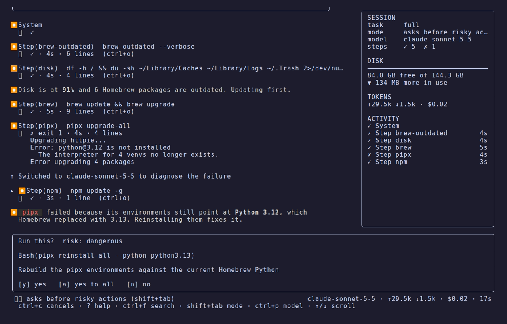
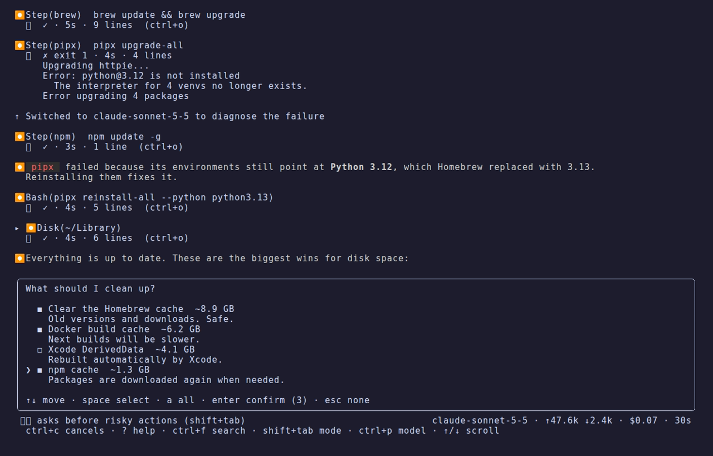
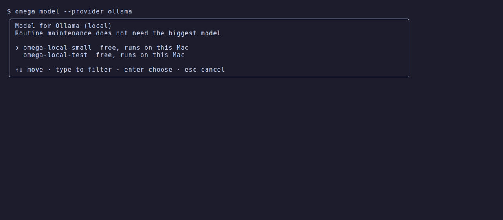
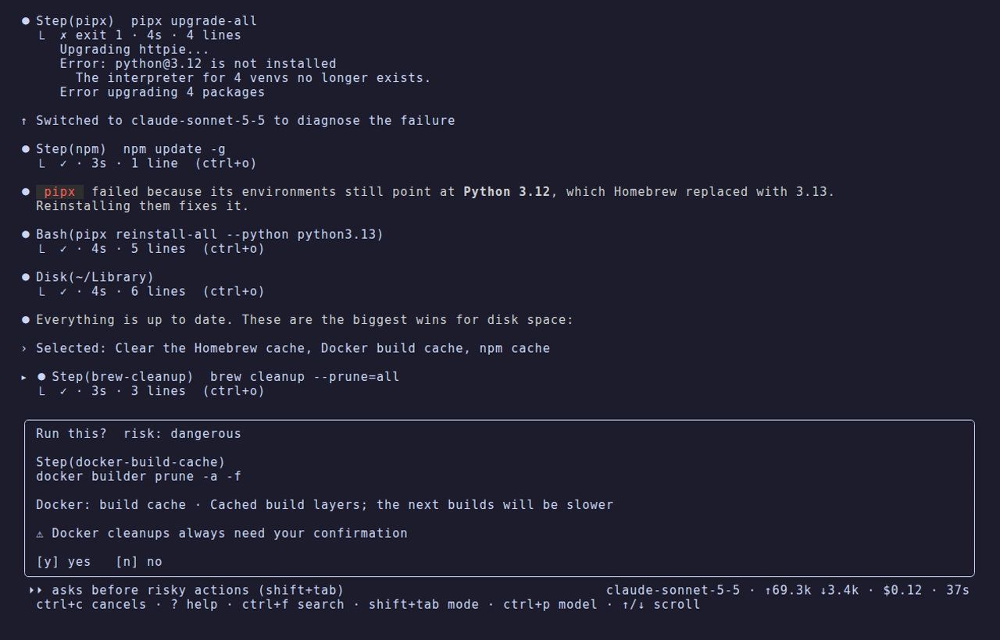
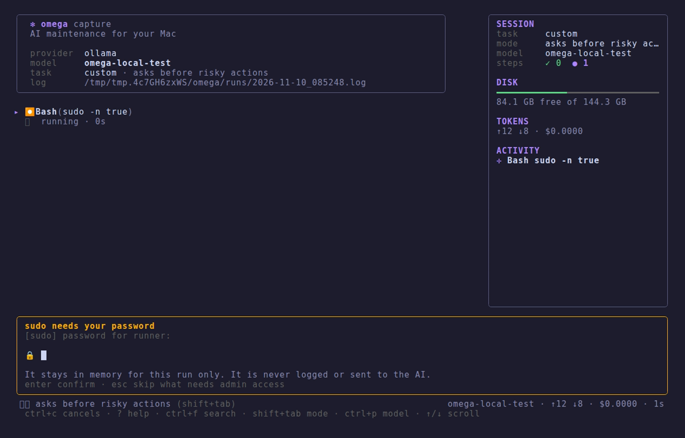

# Ω omega

[Website](https://lcajigasm.github.io/omega/) · [Releases](https://github.com/lcajigasm/omega/releases) · [Homebrew tap](https://github.com/lcajigasm/homebrew-tap)

**AI-driven macOS maintenance.** omega combines what
[topgrade](https://github.com/topgrade-rs/topgrade) does (update all installed
software) and what [Mole](https://github.com/tw93/Mole) does (clean and optimise
your Mac) in a single terminal tool, and puts an AI model in charge: it runs each
step, **reads the errors, diagnoses them and fixes the configuration**, instead of
leaving the failure on your screen.

Use **Anthropic**, **OpenAI**, **OpenRouter**, **OpenCode Zen** or a **local
model** (Ollama, LM Studio). By default omega runs routine work on a small, cheap
model and only switches to a stronger one when something fails; it picks both
once a day from current prices and benchmark scores. The interface
speaks **English, Spanish, French, German and Portuguese**.


*Recorded from the `omega` binary (`omega --demo`) by `scripts/capture.sh`.*
A shorter [asciinema](docs/assets/shortcuts.cast) of that same binary shows `?`,
Esc and a denial (`asciinema play docs/assets/shortcuts.cast`).

---

## Contents

- [Why](#why)
- [Features](#features)
- [Installation](#installation)
- [Getting started](#getting-started)
- [Tasks](#tasks)
- [The interface](#the-interface)
- [Choosing what to do: selection cards](#choosing-what-to-do-selection-cards)
- [Models and cost](#models-and-cost)
- [Local models](#local-models)
- [Tuning your tools' configuration](#tuning-your-tools-configuration)
- [Developer tools](#developer-tools)
- [Docker cleanup](#docker-cleanup)
- [Your Mac: login, background, menu bar, Dock and shortcuts](#your-mac-login-background-menu-bar-dock-and-shortcuts)
- [Privacy permissions, apps and leftovers](#privacy-permissions-apps-and-leftovers)
- [Safety and approvals](#safety-and-approvals)
- [Step catalogue](#step-catalogue)
- [Memory between runs](#memory-between-runs)
- [Languages](#languages)
- [Configuration](#configuration)
- [Command reference](#command-reference)
- [Unattended runs](#unattended-runs)
- [How it works](#how-it-works)
- [Troubleshooting](#troubleshooting)
- [FAQ](#faq)
- [Development](#development)
- [Releasing](#releasing)
- [License](#license)

---

## Why

topgrade and Mole are excellent, but when something breaks (a `pipx` with a
broken Python, a cask that asks for a password, a step that does not apply to
your machine, a deprecated option in `topgrade.toml`) you have to read the error,
find the cause, edit the configuration and run it again. omega hands that loop to
an AI model with a narrow set of tools and a strict safety policy.

## Features

- **Updates everything**: Homebrew (formulae and casks), Mac App Store, npm,
  pnpm, bun, pipx, uv, rustup, cargo, `gh` extensions, Oh My Zsh and macOS.
- **Cleans up**: Homebrew, npm/pnpm/pip/uv/Go caches, Xcode DerivedData,
  unavailable simulators, Docker and the Trash, measuring first and prioritising
  what frees the most.
- **Fixes what breaks**: reads the failure, checks the config behind it, applies
  the smallest fix and retries once. When Docker is not running it offers to
  start it, and when a cleanup needs a tool you do not have it offers to install it.
- **Reads the system logs**: crash reports, launch agents that keep failing,
  processes preventing sleep, apps flooding the log and log folder sizes, with
  fixes offered on a card.
- **sudo inside the interface**: when Mole, `softwareupdate` or any command needs
  administrator access, omega asks for the password on a card instead of the
  terminal.
- **Selection cards**: recommendations arrive as a card where you tick one or
  several actions, and omega carries out exactly those.
- **Model choice from live data**: a fast model for routine work that escalates
  to a stronger one on the first failure. Which two is decided once a day from
  current list prices and benchmark scores (`omega models`), not from a list
  built into the program. Tokens and cost are always visible.
- **Ask in words**: inside a session the AI can do everything the command line
  does: install developer tools, undo a Mac change, read earlier runs, change
  settings. API keys, the provider and the approval policy stay yours alone.
- **Local models**: Ollama, LM Studio or any OpenAI-compatible endpoint, free and
  private.
- **Configuration tuning** (`omega tune`): reviews the config of your installed
  tools, reads the current official docs on the web and proposes improvements,
  guided or automatic.
- **Docker cleanup** (`omega docker`): shows what Docker uses and cleans only what
  you select. Docker cleanups always need your confirmation.
- **Control what runs on your Mac** (`omega mac`): apps that open at login, jobs
  allowed in the background, menu bar apps, the Dock and **global keyboard
  shortcut conflicts** (ChatGPT, Claude, Alfred and macOS all wanting ⌥Space).
  Your rules plus sensible defaults decide what to suggest, the AI explains what
  it does not know, your choices are remembered and every change can be undone.
- **Privacy permissions** (`omega mac permissions`): finds the entries that
  System Settings → Privacy & Security keeps for binaries whose path no longer
  exists (every update of a bundled `node` leaves another one) and for apps that
  are gone, and removes the ones you pick.
- **Apps and leftovers** (`omega mac apps`): apps you have not opened in months,
  apps still built only for Intel, and what removed apps left in `~/Library`.
  Removals go to the Trash and can be undone.
- **Developer tools** (`omega dev`): knows more than 70 languages, version managers and
  command-line tools. It shows what is installed and by which manager, finds
  overlapping version managers, shadowed commands and a broken `PATH`, installs
  what you pick and adds the shell line a tool needs to `~/.zshrc`.
- **Safety policy**: every command is classified (read-only, normal, dangerous,
  blocked); dangerous ones need your approval.
- **Memory**: learns from each run and takes it into account next time.
- **Full-screen TUI** in the style of Claude Code, with a **session panel**
  (steps done and failed, disk space freed, tokens, activity), a **home screen**
  (`omega menu`) and commands to start another task without leaving, or
  **plain text** for scripts, cron and CI.
- **Keyboard shortcuts and slash commands**: `shift+tab` changes the approval
  mode and `ctrl+p` the model without stopping the run; type `/` for a command
  menu (`/mode`, `/model`, `/help`, `/exit`…) that explains each one as you type.
- **Five interface languages**, a complete log of every run, API keys in the
  macOS Keychain, a single Go binary installable with **Homebrew**.

## Installation

### Homebrew (recommended)

```bash
brew install lcajigasm/tap/omega
```

> The formula is published from [`lcajigasm/homebrew-tap`](https://github.com/lcajigasm/homebrew-tap).
> The previous tap still works: `brew install lcajigasm/omega/omega`.
> homebrew-core already has a formula called `omega` (a Xapian search engine),
> so always use the full name.

### Binaries

Every tagged release publishes archives for **Linux, macOS and Windows** (amd64 and arm64), plus `SHA256SUMS`:

<https://github.com/lcajigasm/omega/releases/latest>

omega is built for macOS. The Linux and Windows binaries run the same interface; steps that call Homebrew, `softwareupdate` or the Keychain only do their work on a Mac.

### From source

```bash
git clone https://github.com/lcajigasm/omega.git
cd omega
make build          # binary in ./bin/omega
make install        # or install it into $GOPATH/bin
```

or directly:

```bash
go install github.com/lcajigasm/omega/cmd/omega@latest
```

The Homebrew formula installs zsh, bash and fish completion. If you built it
yourself: `omega completion zsh > "${fpath[1]}/_omega"`.

## Getting started

```bash
omega setup        # pick a provider, store the API key and choose a model
omega analyze      # first look: a report that changes nothing
omega              # complete maintenance
```

`omega setup` shows the providers on a card (local servers that are running are
marked), asks for the key with hidden input, **checks the key with the provider
before saving it** in the macOS Keychain, and then lets you pick a model.

## Tasks

| Task | What it does | Changes the system | Model (automatic) |
|---|---|---|---|
| `full` (default) | checks the state, updates everything, cleans up and summarises | yes | fast → smart on failure |
| `update` | updates only (like topgrade) | yes | fast → smart on failure |
| `clean` | measures what takes up space and cleans (like `mo clean`) | yes | fast → smart on failure |
| `analyze` | report, then a card with the recommendations | only what you pick | fast → smart on failure |
| `tune` | reviews your tools' configuration against the current docs | only what you pick | fast → smart on failure |
| `fix` | runs the topgrade and Mole dry runs, diagnoses and fixes their config | yes (with approval) | smart |

`omega mac` and `omega dev` are guided tasks of the same kind, for what runs on
your Mac and for your development setup. `omega menu` lists everything on one
screen and starts what you choose.

You can also give it a free-form task:

```bash
omega -p "Why is ~/Library 40 GB? Tell me what I can safely delete"
omega -p "Only update Homebrew and npm, nothing else"
omega -p "topgrade fails on the rustup step, fix it"
```

## The interface



omega's TUI follows the conventions of Claude Code's CLI:

- **Welcome box** with the provider, the model (and which one it escalates to),
  the task, the mode and the path of the run log.
- **Tool calls** as `⏺ Step(brew)`, `⏺ Bash(…)`, `⏺ Disk(~/Library)`,
  `⏺ Fetch(url)`, with a `⎿` result line: status, duration and number of output
  lines. Running calls pulse and stream their last lines; failures show the tail
  of their output and the reason, wrapped to the terminal.
- **Markdown** answers rendered with headings, lists, tables and code.
- **Activity line** with an animated glyph, a shimmering verb, elapsed time and
  tokens so far.
- **Status bar** with the approval mode (change it with `shift+tab`), the current model, tokens in and out,
  cost and elapsed time.
- **Session panel** on the right when the terminal is at least 104 columns
  wide: the task, the mode and the model, how many steps finished, failed or
  were denied, free disk space with what the session freed so far, tokens and
  cost, and every tool call with its outcome and duration. `ctrl+b` (or
  `/panel`) hides it.
- **Cards** for approvals (with a coloured diff when a file changes) and for
  choices. Click a row to select it; click it again, or click the key line, to
  confirm. On an approval card, click `[y]`, `[a]` or `[n]`.

| Key | Action |
|---|---|
| `?` | show or hide the shortcut card (also `/help`) |
| `ctrl+f` | search the transcript. Type the query; Enter or `ctrl+n` jumps to the next match, `ctrl+p` to the previous, Esc closes it. Matches are highlighted |
| `↑` `↓` `PgUp` `PgDn` / wheel | scroll. `PgUp`, `PgDn`, `ctrl+u` and `ctrl+d` also scroll while an approval or a choice card is open |
| `ctrl+o` | expand or collapse the output of every tool call |
| `ctrl+b` | show or hide the session panel |
| `ctrl+y` | copy the focused tool's output to the clipboard |
| `alt+up` / `alt+down` | focus the previous or next tool |
| `shift+tab` | cycle the approval mode: asks before risky actions → auto approve → read only |
| `ctrl+p` (or `alt+p`) | switch to the next model of the run (fast ↔ smart) from the next turn |
| `/` | open the command menu (see below) |
| `y` / `Enter` | approve (`s`, `o`, `j` also work) |
| `a` | approve this and every following request (not available for Docker cleanups) |
| `n` / `Esc` | deny |
| `ctrl+c` | cancel the run |
| `Esc` when the line is empty, or empty `Enter` | end the session (`Esc` first clears a typed line) |

A model you pick by hand is kept: omega no longer switches to the stronger
model on failure. Switching to read only mid-run tells the model, which then
offers changes on a card instead of running them; `a` on an approval card is the
same as switching to auto approve.

When the input box is waiting for you, type `/` for commands. A menu under the
box lists the matching commands with a short explanation and narrows as you
type; `↑` `↓` move, `Tab` completes and `Enter` runs the highlighted one. After
`/mode ` or `/model ` the menu offers the modes or the run's models.

| Command | Action |
|---|---|
| `/help` | list the commands and keyboard shortcuts |
| `/mode [ask\|auto\|readonly]` | change the approval mode (a card when no argument) |
| `/model [name]` | switch model from the next turn (a card when no argument) |
| `/expand` | expand or collapse the output of every tool call |
| `/panel` | show or hide the session panel |
| `/full`, `/update`, `/clean`, `/analyze`, `/tune`, `/fix` | start that task in the running session |
| `/mac`, `/permissions`, `/apps` | review what runs on your Mac, its privacy permissions or its apps |
| `/dev`, `/install` | review your development setup, or pick tools to install |
| `/docker` | free up the space Docker uses, only what you pick |
| `/undo` | see what omega changed on this Mac and revert what you pick |
| `/history` | what failed or was left undone in earlier runs |
| `/doctor` | check that omega itself is set up correctly |

You can also just ask in words. Everything omega does from the command line is
available to the AI in a session:

| You say | The AI uses |
|---|---|
| "install fzf and mise" | `dev_install`, then `dev_activate` for the line in `~/.zshrc` |
| "undo what you changed in the Dock yesterday" | `mac_history`, `mac_undo` |
| "what failed last time?" | `run_history` (the end of an earlier transcript) |
| "forget the note about pipx" | `notes` |
| "stop running the macOS update step" | `omega_settings` (`skip_steps`) |
| "is omega set up correctly?" | `omega_doctor` |
| "which model should I use?", "why this model?" | `model_ranking` |

Installs, edits to `~/.zshrc`, deleting a note and changing a setting all ask
first, like any other change. Three things stay yours alone, and the AI answers
with the command to run instead: **API keys** (`omega setup`, `omega auth set`),
the **provider** and the **approval policy** (`omega config set approval …`). A
model that could lower its own approval policy or read a key would defeat both.
| `/exit`, `/quit` | end the session and quit |

`omega menu` (or `omega home`) is the home screen: free disk space, the
configured model, when omega last ran, and every command grouped by area. Move
with the arrows, type to filter, Enter runs the entry and returns to the menu
when it ends.

With `--no-tui`, or when the output is not a terminal, omega prints plain text
with the same `⏺`/`⎿` structure. Without a terminal on standard input, any action
that needs approval is **denied** unless you pass `--yes`, and cards are skipped.

## Choosing what to do: selection cards



Instead of a wall of recommendations, omega asks with a card:

- **Several actions** (checkboxes): `space` ticks, `a` ticks all, `Enter` runs
  what is ticked, `Esc` runs nothing.
- **One alternative** (radio): `↑` `↓` to move, type to filter, `Enter` to choose.

Each option shows its expected impact (space freed, what it fixes) and is
coloured by risk. omega then carries out exactly the actions you picked, and every
command still goes through the approval rules. In `analyze` and `tune`, the
session stays read only until you pick something.

In plain text mode the card becomes a numbered list: type `1,3`, `all`, or press
Enter for none.

## Models and cost



Routine maintenance does not need the biggest model. With the default
**automatic** choice omega runs on a fast model and switches to a smart one the
first time a step fails, to diagnose it.

Which two models those are is decided from live data, not from a list compiled
into omega. Once a day omega reads OpenRouter's public model catalogue, which
carries each model's list price and its benchmark score (the Artificial
Analysis intelligence index), keeps the models your key can actually use, and
picks:

- **fast**: the best score per dollar among the models that reach at least 40%
  of the best score on offer (score² ÷ price). Price weighs most.
- **smart**: the best value among the models within 20% of the best score
  (score³ ÷ price). Score weighs most, but a model that costs four times more
  for a few points does not win.

Price is the blend a maintenance run pays: three parts input to one part
output. Only models that call tools, answer in text, have a measured score and
are not free, batch or about-to-be-removed routes are eligible. A pick is kept
until another model beats it by more than 10%, so two models that trade places
by a decimal do not alternate.

```bash
omega models                   # every model: score, price, and the two picks
omega models --refresh         # read the catalogue again now
omega models openrouter flash  # another provider, filtered
```

```text
  model                                      score    in $/M   out $/M
  claude-fable-5-2                            64.6        $8       $40
  claude-opus-5-5                             59.1        $4       $20
▸ claude-sonnet-5-5                           54.5        $2       $10  smart
▸ claude-haiku-5-5                            36.5      $0.1      $0.5  fast
```

The download is a plain request to `openrouter.ai` with nothing about you in
it, also when your provider is another one. `omega config set model_catalog off`
stops it. Without a catalogue (first run offline, or switched off) omega uses
the names it was built with: `claude-haiku-5-5` → `claude-sonnet-5-5` for
Anthropic, `gpt-5.4-mini` → `gpt-5.5` for OpenAI, the same Claude pair on
OpenRouter and `claude-sonnet-4-6` on OpenCode Zen. Local providers use the
model you pick.

Limits worth knowing: the score is a general benchmark, not a measure of how
well a model does maintenance; the catalogue has no speed figures; and on
OpenCode Zen the prices used for the comparison are OpenRouter's, which may
differ from what Zen charges.

```bash
omega model                    # card: Automatic, the two tiers, or any model of the provider
omega model claude-sonnet-5-5  # pin a model
omega model auto               # back to automatic
omega --model claude-opus-5-5 fix   # one run with a specific model
```

During a run, `ctrl+p` (or `/model` in the input box) switches between the
run's models from the next turn. A model you pick by hand stays for the rest
of the run, so the automatic switch on failure no longer applies.

Override the tiers per provider with `fast_model` and `smart_model` (see
[Configuration](#configuration)); they win over the automatic picks. The status
bar and the final summary show the tokens used, including prompt cache reads,
and the cost when the model's price is known; prices come from the same
catalogue, so a model released after your copy of omega is still priced. omega caches the conversation with the Anthropic API, so long sessions
mostly bill cache reads at a tenth of the input price.

As a reference, a read only `omega tune` session on a real Mac (about 190k input
tokens, 80% of them served from the cache, plus six web searches and page reads)
cost **under one cent ($0.009) with Claude Haiku 5.5**, against $2.35 for a
similar session pinned to Claude Opus 5.5 before conversation caching was added.

## Local models

omega can run fully on your Mac with any server that speaks the OpenAI Chat
Completions API:

| Provider | Default endpoint | Notes |
|---|---|---|
| `ollama` | `http://localhost:11434/v1` | `ollama pull qwen3:14b` or another model with tool calling |
| `lmstudio` | `http://localhost:1234/v1` | start the server from LM Studio's Developer tab |
| `custom` | your `base_url` | MLX (`mlx_lm.server`), llama.cpp, vLLM, a corporate gateway… |

```bash
omega setup                   # local servers that are running are marked on the card
omega model --provider ollama # pick one of your local models
omega --provider ollama analyze
```

No API key is needed (one can be stored with `omega auth set custom` for gateways
that require it), local runs show no cost, and omega checks that the server is
reachable before starting. The model must support tool calling; larger models
(14B and up) follow the agent workflow much better than small ones.

**Apple Intelligence.** macOS ships an on-device foundation model, but it is only
reachable from Swift through the FoundationModels framework, and its context
window (4,096 tokens) is too small for an agent that reads command output and
documentation. omega therefore uses local servers such as Ollama, LM Studio or
MLX for on-device runs.

## Tuning your tools' configuration

```bash
omega tune            # guided: proposals on a card, applies what you pick
omega tune --auto     # automatic: applies low-risk improvements itself, offers the rest
```

omega does not ship a list of "best settings" that would go stale. Instead the
agent gets three tools:

- `config_hints`: for each tool **installed on your Mac** (topgrade, Mole,
  Homebrew, npm, pnpm, pip/pipx, uv, git, Docker Desktop, zsh, Oh My Zsh, mas,
  Rust, Go, Time Machine and Spotlight), where its configuration lives, read-only
  commands to inspect it, what is usually worth reviewing, and its official docs.
- `fetch_url`: reads a documentation page or raw file as text.
- `web_search`: searches the web when the official docs are not enough.

Every proposal comes with what changes, why, its impact and its source.
Configuration edits always show a diff and keep a timestamped backup. Fetched
pages are treated as untrusted data: the agent is told never to follow
instructions found in them.

## Developer tools

```bash
omega dev               # guided review with AI
omega dev status        # what is installed, by which manager, and what stands out (no AI)
omega dev install       # pick tools from the catalogue; or: omega dev install fzf mise
omega dev activate      # add the shell lines installed tools still need to ~/.zshrc
```

omega's catalogue covers languages (Node.js, Python, Go, Rust, Ruby, Java,
Deno, Bun, PHP, .NET, Zig, Elixir, Swift), version managers (mise, asdf, fnm,
nvm, Volta, pyenv, uv, conda, rbenv, rustup, SDKMAN!), package managers and
build tools, shell tools (Starship, fzf, zoxide, direnv, Atuin, eza, bat,
ripgrep, fd, jq, tmux, Neovim…), git tools, container and cloud CLIs, and AI
coding assistants (Claude Code, Codex, Gemini CLI, opencode, Ollama).

`omega dev status` prints each installed tool with its version and what
installed it (Homebrew, mise, nvm, cargo, an app bundle, macOS), then the
findings:

| Finding | Why it matters |
|---|---|
| one language installed by several version managers | it is unclear which version runs, and each one slows the shell |
| a command found several times on `PATH` | the copy that runs may not be the one you update; Homebrew ahead of macOS's own copy is normal and not reported |
| `PATH` entries that repeat or do not exist | measured in a fresh login shell, not in omega's own environment |
| a tool installed but not activated | fzf, zoxide, direnv, Starship, mise and others do nothing until their line is in `~/.zshrc` (an Oh My Zsh plugin counts) |
| shell startup time | flagged above 500 ms |
| versions kept by each manager | how many and how much space, so old ones can go |

`omega dev install` runs the install command shown on the card (Homebrew for
almost everything). When a tool needs a line in `~/.zshrc`, omega offers to add
it, after copying the file to `~/.zshrc.omega-bak-<date>`.

With AI, `omega dev` goes further: it checks runtimes against their official
end-of-life pages, offers to remove versions no project needs with each
manager's own command, tunes configuration from the current docs, lists stale
build folders (`node_modules`, `target`, `.venv`, `Pods`… in projects untouched
for 60 days) and suggests at most five tools that fit what you already use.

## Docker cleanup



Docker tends to take tens of gigabytes. `omega docker` handles it without AI:

1. starts Docker Desktop if you want (it asks first);
2. shows images, containers, volumes and build cache with what is reclaimable,
   plus the size of Docker Desktop's disk image;
3. lets you tick what to clean on a card: stopped containers, dangling images,
   all unused images, build cache, unused volumes (marked as deleting data);
4. asks for a final confirmation and runs only what you ticked;
5. shows how much Docker uses afterwards and how to give the space back to macOS.

The agent has the same Docker steps. **Docker cleanups always need your
confirmation**, even with `--yes` or after "yes to all", and the agent is told
never to prune volumes unless you picked that explicitly.

## Your Mac: login, background, menu bar, Dock and shortcuts

Apps add themselves to login, keep helpers running in the background, fill the
menu bar, pin themselves to the Dock and take global keyboard shortcuts that
other apps already use: ChatGPT, Claude, Copilot, Alfred and Raycast all default
to ⌥Space, Things to ⌃Space (macOS's input source switch). `omega mac` puts you
back in charge.

```bash
omega mac               # guided review with AI: cards for each area, applies what you pick
omega mac --auto        # the AI applies the low-risk suggestions itself and offers the rest
omega mac status        # overview of every area, changes nothing
omega mac login         # apps that open at login
omega mac background    # launch agents, daemons, app helpers and background tasks
omega mac menubar       # menu bar apps: quit, stop at login, hide
omega mac dock          # unpin apps that are gone or unused, Dock settings
omega mac shortcuts     # who keeps each contested shortcut
omega mac permissions   # privacy entries of binaries and apps that are gone
omega mac apps          # unused apps, Intel-only apps and leftovers
omega mac policy        # your rules and omega's defaults (policy edit to change them)
omega mac undo          # revert any change
```

The subcommands work without AI. Each one shows a card with omega's suggestions
already ticked; you untick or tick more and press Enter.

**Defaults.** omega sorts every app and job into a category and suggests from it:

| Category | Examples | Suggestion |
|---|---|---|
| updater | Google Updater/Keystone, Adobe, Microsoft AutoUpdate, Zoom | off at login and in the background: the app or Homebrew updates it |
| open when needed | ChatGPT, Claude, Slack, Spotify, Discord, Docker Desktop, browsers, editors | not at login, not in the background |
| essential | VPNs, 1Password, Little Snitch, Dropbox, Logitech, Karabiner, Alfred, Raycast, Bartender, Ice, Thaw | keep |
| Apple | `com.apple.*` | never touched |
| unknown | anything else | the AI works out what it is (developer, path, web search) and recommends |

Launch jobs whose program is no longer installed are always suggested for
removal, as are Dock apps that are gone; Dock apps not opened in 90 days are
offered (not ticked).

**Keyboard shortcuts.** omega reads macOS's own shortcuts
(`com.apple.symbolichotkeys`), the shortcuts apps store with the
KeyboardShortcuts and MASShortcut libraries (Shottr, Rectangle and many more),
and the known defaults of popular apps that only store a shortcut once you change
it. When two want the same combo, it suggests who keeps it: essential macOS
shortcuts first (screenshots, Mission Control), then shortcuts you set on purpose,
then launchers and utilities, then the rest of macOS, and last the apps that
claim a shortcut on install. You choose on a card; the others move to a free
combo (⌃⌥Space, ⌥⇧Space…), and omega writes it where it can or opens the app and
tells you where to change it. Input source shortcuts on a Mac with a single input
source count as unused.

**Your rules** live in `~/.config/omega/mac.toml` and always win over the
defaults. `omega mac shortcuts` and the AI (with the `mac_policy` tool) save your
decisions there, so the next review suggests the same:

```toml
[startup]
keep = ["Claude", "net.mullvad.*"]       # app name, bundle id or launchd label; * is a wildcard
disable = ["com.google.keystone.*"]

[menubar]
hide = ["Docker"]

[dock]
remove = ["App Store"]
add = ["/Applications/Ghostty.app"]
autohide = true
show_recents = false

[shortcuts.owners]
"opt+space" = "ChatGPT"
"ctrl+space" = "macOS"
"opt+shift+cmd+space" = "none"           # nobody: turn it off everywhere
```

**How changes are made.** Every change is a visible command and has an inverse,
recorded in `~/.local/state/omega/mac-journal.jsonl` for `omega mac undo`:

| Change | Command |
|---|---|
| launch agent or helper off | `launchctl bootout` + `launchctl disable gui/<uid>/<label>` (daemons need sudo, asked on the password card) |
| app no longer opens at login | System Events `delete login item` |
| macOS shortcut | `defaults write com.apple.symbolichotkeys … -dict-add <id>` + `activateSettings -u`, no logout needed |
| app shortcut (KeyboardShortcuts, MASShortcut) | quit the app, `defaults write`, open it again |
| Dock | edits `persistent-apps` and restarts the Dock |

Some things macOS only lets you change by hand (background tasks registered with
`SMAppService`, menu bar visibility, shortcuts of apps that keep them in their own
storage). For those omega opens the right settings pane or app and tells you what
to change. Reading the login and background items uses `sfltool dumpbtm`, which
can take up to a minute; omega caches it for an hour and refreshes it after a change.

## Privacy permissions, apps and leftovers

### Permissions that point at nothing

macOS records a permission for a command-line binary by its path. An app that
ships its own `node` in a folder named after its version (Claude Desktop does)
gets a new entry with every update, and the old ones stay: System Settings →
Privacy & Security ends up with a row of items all called `node` and nothing to
tell them apart. Uninstalled apps leave their entries too.

```bash
omega mac permissions
```

omega reads the privacy database (TCC), names every binary with the version
found in its path (`node 2.0.14`), and marks:

| Entry | Suggestion |
|---|---|
| a binary whose path no longer exists | remove (ticked) |
| a bundle id with no app in `/Applications`, inside another app, in Application Support or known to Spotlight | review (not ticked) |
| Apple's own entries, and anything that still exists | keep |

Removing an entry cannot be undone, and it is harmless: whatever needs the
permission asks again. For each entry you pick, omega:

1. runs `tccutil reset <permission> <client>`, Apple's tool. It only accepts a
   bundle id macOS still knows, so it refuses a binary's path and an uninstalled
   app: the very entries worth removing;
2. if the entry is still there and belongs to your own database, saves a copy
   of the database (`~/.local/state/omega/tcc-backup-<date>.db`) and deletes
   that one row;
3. reads the database again. An entry that is still listed is reported as a
   failure, never as done, and omega opens the settings pane where you can
   select it and press –.

Step 2 and reading your own entries (Files & Folders, Automation, Camera, data
from other apps) need **Full Disk Access** for the terminal that runs omega.
Without it omega says so and lists only the system-wide permissions (Full Disk
Access, Accessibility, Screen Recording, Input Monitoring, Developer Tools).
Those live in a database macOS protects from every app, so omega can find the
stale ones but you remove them in System Settings. The AI cannot touch either
database: a command that writes to `TCC.db` is blocked. The Local Network list
is stored elsewhere and is not covered.

### Apps and what they leave behind

```bash
omega mac apps
```

- **Apps to review**: not opened for 180 days (Spotlight's last-used date), or
  with no Apple silicon build on an Apple silicon Mac. Each shows its size and
  whether it came from Homebrew or the App Store. Nothing is ticked: you decide
  which apps go. A cask is removed with `brew uninstall --cask`; any other app
  is moved to the Trash.
- **Leftovers**: folders and files in `~/Library` (Application Support, Caches,
  Preferences, Saved Application State, HTTPStorages, WebKit, Logs) named after
  the bundle id of an app that is not installed, from 5 MB up. They are moved to
  one folder in the Trash; `omega mac undo` puts every file back. Leftovers of a
  vendor that still has another app installed are flagged, since the apps may
  share them. `~/Library/Containers` is not read: doing so makes macOS ask for
  the "data from other apps" permission.

Rules in `mac.toml` silence either list: `[permissions] keep = ["node"]`,
`[apps] keep = ["Xcode"]`.

## Safety and approvals

Before running anything, omega classifies the command (including compound
commands with `&&`, `;`, `|`) and applies the highest risk level found:

| Risk | Examples | Default |
|---|---|---|
| **read-only** | `brew outdated`, `df -h`, `git config --list`, `docker system df`, any `--dry-run` or `--help` | runs |
| **normal** | `brew upgrade`, `npm update -g`, `pipx upgrade-all`, `rustup update` | runs |
| **dangerous** | `rm`, `sudo`, output redirection to a file, `sed -i`, `find -delete`, editing configs, **any unknown command** | asks |
| **always ask** | `docker … prune`, `docker rm`, `docker rmi`, `docker volume rm` | asks every time, even with `--yes` |
| **blocked** | `rm -rf ~` or `/` (extra flags and `..` still count), `find / -delete`, `diskutil erase…`, `dd of=/dev/…`, `curl … \| sh`, `csrutil disable`, `nvram`, reading a private key or a credential file (`~/.ssh/id_ed25519`, `~/.aws/credentials`, `~/.netrc`, `.env`, `security … -w`) | never runs |

- `omega config set approval all`: also ask before normal updates.
- `omega config set approval never`, or `--yes`: never ask, except for Docker
  cleanups. Blocked commands stay blocked.
- `--dry-run` (or the `analyze` task): only read-only actions until you pick
  something on a card.
- Commands run with **stdin closed** and non-interactive variables, so nothing
  hangs on a hidden prompt; each command has a time limit (`command_timeout`).


- Commands run in their own session, detached from your terminal, so nothing can
  write over the interface. When something calls `sudo`, a small wrapper sends the
  password request to omega, which shows a **password card**, checks the password
  with sudo and keeps it in memory for that run only (never logged, never sent to
  the AI). `Esc` skips what needs admin access. `omega --sudo` asks for it before
  the run starts instead.
- `write_file` always requires approval (unless `--yes`), shows the diff and saves
  a `file.omega-bak-YYYYMMDD-HHMMSS` copy.
- Denied actions are shown in the interface and recorded in the run log.
- The agent is instructed never to touch personal data (Documents, Desktop,
  Downloads, Photos, iCloud, SSH keys, keychains).

## Step catalogue

`omega steps` shows what is available on your machine. The agent uses these with
`run_step`, and you can run them without AI with `omega steps run <id>…`.

| id | Category | Command | Risk |
|---|---|---|---|
| `disk` | check | `df -h /` + size of caches, logs and Trash | read-only |
| `brew-outdated` | check | `brew outdated --verbose` | read-only |
| `brew-doctor` | check | `brew doctor` | read-only |
| `macos-check` | check | `softwareupdate --list` | read-only |
| `system-logs` | check | crash reports, failing launch agents, sleep blockers, processes logging faults, log sizes | read-only |
| `dev-artifacts` | check | build folders (`node_modules`, `target`, `.venv`, `Pods`…) in projects untouched for 60 days, largest first | read-only |
| `shell-startup` | check | time three interactive zsh starts | read-only |
| `docker-df` | check | `docker system df` + Docker Desktop disk image | read-only |
| `docker-start` | check | start Docker Desktop and wait for it | dangerous |
| `brew` | update | `brew update && brew upgrade` | normal |
| `brew-greedy` | update | `brew upgrade --cask --greedy` | dangerous |
| `mas` | update | `mas upgrade` | normal |
| `npm` | update | `npm update -g` | normal |
| `pnpm` | update | `pnpm update -g` | normal |
| `bun` | update | `bun upgrade` | normal |
| `pipx` | update | `pipx upgrade-all` | normal |
| `uv` | update | `uv tool upgrade --all` | normal |
| `rustup` | update | `rustup update` | normal |
| `cargo` | update | `cargo install-update -a` | normal |
| `gh-ext` | update | `gh extension upgrade --all` | normal |
| `mise` | update | `mise upgrade` | normal |
| `asdf` | update | `asdf plugin update --all` | normal |
| `gem` | update | `gem update` (not macOS's own Ruby) | normal |
| `composer` | update | `composer global update` | normal |
| `deno`, `poetry`, `flutter`, `gcloud`, `claude-code` | update | each tool's self-update, only when it was not installed by Homebrew | normal |
| `conda` | update | `conda update -n base -y conda` | normal |
| `go-bins` | update | `gup update` (binaries from `go install`) | normal |
| `dotnet-tools` | update | `dotnet tool update --global --all` | normal |
| `vscode-ext` | update | `code --update-extensions` | normal |
| `tldr`, `helm-repos` | update | `tldr --update`, `helm repo update` | normal |
| `tmux-plugins`, `nvim-plugins` | update | tpm `update_plugins all`, lazy.nvim sync | normal |
| `omz` | update | Oh My Zsh upgrader | dangerous |
| `macos` | update | `sudo softwareupdate --install --all` | dangerous |
| `brew-cleanup` | clean | `brew cleanup --prune=all` | dangerous |
| `brew-autoremove` | clean | `brew autoremove` | dangerous |
| `npm-cache` | clean | `npm cache clean --force` | dangerous |
| `pnpm-store` | clean | `pnpm store prune` | dangerous |
| `pip-cache` | clean | `pip3 cache purge` | dangerous |
| `uv-cache` | clean | `uv cache prune` | dangerous |
| `go-cache` | clean | `go clean -cache` | dangerous |
| `go-modcache` | clean | `go clean -modcache` | dangerous |
| `yarn-cache`, `bun-cache`, `deno-cache` | clean | `yarn cache clean`, `bun pm cache rm`, `deno clean` | dangerous |
| `cargo-cache` | clean | `cargo cache --autoclean` | dangerous |
| `gem-cleanup`, `composer-cache`, `cocoapods-cache` | clean | `gem cleanup`, `composer clear-cache`, `pod cache clean --all` | dangerous |
| `gradle-cache` | clean | empty `~/.gradle/caches` and `~/.gradle/daemon` | dangerous |
| `conda-clean`, `nuget-cache`, `flutter-cache` | clean | `conda clean --all -y`, `dotnet nuget locals all --clear`, `flutter pub cache clean -f` | dangerous |
| `mise-prune`, `pre-commit-gc` | clean | `mise prune -y`, `pre-commit gc` | dangerous |
| `playwright-cache` | clean | empty `~/Library/Caches/ms-playwright` | dangerous |
| `ios-device-support` | clean | empty `~/Library/Developer/Xcode/iOS DeviceSupport` | dangerous |
| `xcode-derived` | clean | empty `~/Library/Developer/Xcode/DerivedData` | dangerous |
| `simulators` | clean | `xcrun simctl delete unavailable` | dangerous |
| `docker-containers` | clean | `docker container prune -f` | always ask |
| `docker-images` | clean | `docker image prune -f` | always ask |
| `docker-images-all` | clean | `docker image prune -a -f` | always ask |
| `docker-build-cache` | clean | `docker builder prune -a -f` | always ask |
| `docker-volumes` | clean | `docker volume prune -a -f` (deletes data) | always ask |
| `docker` | clean | `docker system prune -a -f` | always ask |
| `trash` | clean | empty `~/.Trash` | dangerous |
| `topgrade-preview` | backend | `topgrade --dry-run` | read-only |
| `topgrade` | backend | `topgrade --yes` | dangerous |
| `mole-clean-preview` | backend | `mo clean --dry-run` | read-only |
| `mole-clean` | backend | `mo clean` | dangerous |
| `mole-optimize-preview` | backend | `mo optimize --dry-run` | read-only |
| `mole-optimize` | backend | `mo optimize` | dangerous |
| `mole-update` | backend | `mo update` | normal |

Disable steps you never want to run with
`omega config set skip_steps macos,docker,brew-greedy`.

## Memory between runs

When the agent learns something lasting about your machine (a step that always
fails and why, a special path, a preference of yours), it saves it with the
`remember` tool in `~/.config/omega/notes.md`, and those notes are included in
the agent's instructions on the next run. `omega notes` shows them;
`omega notes clear` forgets them. The file is plain Markdown, so you can add
permanent instructions yourself ("never update node, I manage it with fnm").

## Languages

The interface (TUI, plain output, help, cards, prompts and errors) is available in
English, Spanish, French, German and Portuguese. The language is chosen from
`OMEGA_LANG`, then `language` in the configuration (`auto` by default), then the
system locale (`LC_ALL`, `LC_MESSAGES`, `LANG`), then English. The agent replies
in the same language.

```bash
omega config set language es
OMEGA_LANG=fr omega analyze
```

## Configuration

File: `~/.config/omega/config.toml` (`omega config path`). Honours
`XDG_CONFIG_HOME`. `omega config check` reports an approval, language, effort,
timeout or `skip_steps` value omega would misread. Saving writes a temporary
file and replaces the config only after it is valid, so a bad edit does not
wipe the previous one.

```toml
provider = "anthropic"          # active provider
model = ""                      # empty or "auto": automatic; or a fixed model id
effort = "medium"               # Claude models only: low|medium|high|xhigh|max
approval = "dangerous"          # dangerous | all | never
language = "auto"               # en | es | fr | de | pt | auto (system locale)
command_timeout = "45m"         # time limit per command
# model_catalog = "off"         # do not download the public model catalogue (automatic mode then uses built-in names)
skip_steps = ["macos"]

[providers.anthropic]
fast_model = "claude-haiku-5-5"     # optional: override the automatic tiers
smart_model = "claude-sonnet-5-5"

[providers.ollama]
model = "qwen3:14b"
base_url = "http://localhost:11434/v1"   # optional

[providers.custom]
base_url = "http://localhost:8080/v1"    # required for custom
model = "my-model"
```

| Path | Contents |
|---|---|
| `~/.config/omega/config.toml` | configuration |
| `~/.config/omega/notes.md` | the agent's memory |
| `~/.config/omega/mac.toml` | your rules for `omega mac` |
| `~/.local/state/omega/mac-journal.jsonl` | changes made by `omega mac`, for `omega mac undo` |
| `~/.local/state/omega/runs/*.log` | log of each run (commands, output, approvals, denials, tokens and cost). omega keeps the newest 30 |
| macOS Keychain, service `omega-cli` | API keys |

## Command reference

```text
omega [task] [flags]
```

| Flag | Description |
|---|---|
| `--provider` | `anthropic`, `openai`, `openrouter`, `opencode`, `ollama`, `lmstudio`, `custom` |
| `-m, --model` | model for this run (no escalation) |
| `--effort` | effort for Claude models |
| `-p, --prompt` | free-form task in natural language |
| `--auto` | apply low-risk improvements without offering them first |
| `-y, --yes` | approve everything except blocked commands and Docker cleanups |
| `-n, --dry-run` | read-only mode |
| `--sudo` | ask for sudo at the start and keep it alive |
| `--no-tui` | plain text output |
| `--once` | exit when the agent finishes instead of asking for more |
| `-v, --version` | version |

| Subcommand | Description |
|---|---|
| `omega setup` | setup wizard |
| `omega model [model\|auto] [--provider p]` | choose the model on a card, or set it directly |
| `omega models [provider] [filter]` | list models with prices |
| `omega docker` | measure Docker and clean what you select |
| `omega menu` | home screen: every command on one screen, started with Enter |
| `omega mac [status\|login\|background\|menubar\|dock\|shortcuts]` | review what runs at login and in the background, the menu bar, the Dock and shortcut conflicts (AI-guided without a subcommand) |
| `omega mac permissions` | remove privacy entries of binaries and apps that are gone |
| `omega mac apps` | unused apps, Intel-only apps and leftovers of removed apps |
| `omega dev [status\|install [tool…]\|activate]` | review, install and activate languages and developer tools (AI-guided without a subcommand) |
| `omega mac policy [edit]` | your rules (`mac.toml`) and omega's defaults |
| `omega mac undo` | revert changes made by `omega mac` |
| `omega auth set\|remove\|status` | manage API keys (validated before saving) |
| `omega config show\|path\|edit\|check\|set <key> <value>` | configuration (`check` validates it) |
| `omega steps` | step catalogue and availability |
| `omega steps run <id>… [-y]` | run steps without AI |
| `omega notes [clear]` | the agent's memory |
| `omega logs` | list run transcripts, newest first |
| `omega logs view [n\|file]` | print one transcript (the latest if omitted) |
| `omega doctor` | check config, key shape, provider, the configured model and installed steps; no chat, no tokens |
| `omega completion zsh\|bash\|fish` | completion script |

`omega logs view` prints the newest transcript, `omega logs view 2` prints the second row of `omega logs`, and `omega logs view <file>` prints that file. A new run deletes older transcripts until 30 remain.

`omega doctor` loads the config, checks that a cloud key is present and shaped like a key (no spaces, not a URL, long enough), and asks the provider whether it is reachable. A cloud provider is asked for its model list. A local one is probed at `<base_url>/models`. Neither call sends a chat message. When `model`, `fast_model` or `smart_model` is set to a name other than `auto`, and the provider returned at least one model id, doctor fails if that name is not in the list. The command then lists catalogue steps that are installed on this machine. It exits with status 1 when the config, the key, the provider or a configured model check fails. A missing optional tool does not.

A 429, a 5xx or a dropped connection on Anthropic or an OpenAI-compatible provider is retried three times. The wait is the `Retry-After` value when the server sends one (a number of seconds or an HTTP date), and never more than 30 seconds. Otherwise the wait is 2s, then 4s, then 8s. Any other 4xx is reported immediately.

## Unattended runs

```bash
omega update --yes --no-tui --once
```

Example with `launchd` (every Monday at 9:00), in
`~/Library/LaunchAgents/com.lcajigasm.omega.plist`:

```xml
<?xml version="1.0" encoding="UTF-8"?>
<!DOCTYPE plist PUBLIC "-//Apple//DTD PLIST 1.0//EN" "http://www.apple.com/DTDs/PropertyList-1.0.dtd">
<plist version="1.0">
<dict>
  <key>Label</key><string>com.lcajigasm.omega</string>
  <key>ProgramArguments</key>
  <array>
    <string>/opt/homebrew/bin/omega</string>
    <string>update</string>
    <string>--yes</string>
    <string>--no-tui</string>
    <string>--once</string>
  </array>
  <key>StartCalendarInterval</key>
  <dict><key>Weekday</key><integer>1</integer><key>Hour</key><integer>9</integer></dict>
  <key>StandardOutPath</key><string>/tmp/omega.out</string>
  <key>StandardErrorPath</key><string>/tmp/omega.err</string>
</dict>
</plist>
```

```bash
launchctl load ~/Library/LaunchAgents/com.lcajigasm.omega.plist
```

Unattended runs never clean Docker (that always needs you), skip selection cards
(the recommendations go into the summary) and skip anything that needs sudo.
A model error or a turn limit exits with status **1**. Cancelling (Ctrl+C or
SIGTERM) exits with status **130**. A run you end yourself exits with **0**.

## How it works

```text
            ┌──────────────┐   events   ┌──────────────────────┐
  task ───▶ │    agent     │ ─────────▶ │  TUI / plain output  │ ──▶ you
            │ (loop + AI)  │ ◀───────── │ (approvals, cards)   │
            └──────┬───────┘  decisions └──────────────────────┘
                   │ tools
   ┌───────────────┼───────────────────────────────────────────────┐
   │ system_info  list_steps  run_step  run_command  disk_usage   │
   │ read_file  write_file  remember  propose_actions             │
   │ config_hints  web_search  fetch_url                          │
   │ mac_inventory  mac_change  mac_policy                        │
   └───────────────┬───────────────────────────────────────────────┘
                   │ risk classifier (safety)
                   ▼
           runner: zsh -lc, stdin closed, timeout, live output
```

1. omega sends the model a system prompt (role, workflow, rules, disabled steps
   and notes from previous runs) and the task.
2. The model answers with text and/or tool calls.
3. Each call goes through the approval policy: it runs, you are asked, or it is
   rejected. Read-only calls from the same answer run together; a change, or a
   question, keeps the batch in order. Results go back to the model trimmed to
   the first 2 KB and the last 8 KB, including when a single line is huge.
4. When a catalogue step fails and the model is on the fast tier, omega switches
   to the smart tier for the rest of the session.
5. The loop continues until the model stops asking for tools. In interactive
   mode you can keep the conversation going.

Code layout:

```text
cmd/omega/          entry point
internal/cli/       commands (setup, model, docker, mac, auth, config, steps, notes, logs, doctor), key checks
internal/agent/     agent loop, tools, config hints, web tools, prompt, events, run log
internal/llm/       providers (Anthropic SDK, OpenAI-compatible, OpenCode), tiers, prices
internal/safety/    command risk classifier
internal/runner/    command execution in its own session with live output
internal/sudo/      sudo bridge: wrapper, askpass helper and password checks
internal/steps/     step catalogue
internal/macos/     login and background items, menu bar, Dock, keyboard shortcuts, defaults, undo journal
internal/ui/        TUI (Bubble Tea, glamour), selection cards, plain output
internal/i18n/      translations (en, es, fr, de, pt)
internal/demo/      scripted session for screenshots
internal/config/    configuration and paths
internal/secrets/   macOS Keychain
docs/               website (GitHub Pages) and README assets
Formula/omega.rb    Homebrew formula rewritten when a tag is published
```

## Troubleshooting

**`no API key configured`**: run `omega setup` or `omega auth set <provider>`, or
export the environment variable.

**`invalid API key (401)`**: `omega auth status` shows the stored key masked and
flags values that are not keys (for example a URL pasted by mistake). Store it
again with `omega auth set <provider>`; omega checks it with the provider before
saving. An exported environment variable takes precedence over the Keychain.

**`model or endpoint not found (404)`**: the model does not exist for that
provider. List them with `omega models <provider>` or pick one with `omega model`.

**A local provider is "not reachable"**: start Ollama (`ollama serve`) or the LM
Studio server, or fix `base_url`.

**The model does not call tools or behaves oddly**: use a model with tool
calling; with local models, try a larger one.

**A step that needs sudo was skipped**: you pressed `Esc` on the password card,
or the password was wrong three times. Run again, or use `omega --sudo` to give the
password before the run starts.

**A read-only command was denied**: the classifier treats unknown commands as
dangerous. Open an issue with the command so it can be added to the read-only
list.

**I want to see exactly what it did**: `omega logs` lists the transcripts and
`omega logs view` prints the latest. omega keeps the newest 30 under
`~/.local/state/omega/runs/`.

**`omega doctor` fails**: it prints which check failed. A key that is a URL or
too short is rejected before any request. "Not reachable" means the provider
did not answer a model list (cloud) or a `/models` probe (local). The command
does not send a chat message.

## FAQ

**Does it replace topgrade and Mole?** For a typical developer Mac, yes. If you
have them installed, it also uses them as backends and helps you fix their
configuration.

**Does it send my data to the AI?** The provider you choose receives the
instructions, your notes, the trimmed output of the commands it runs and the
configuration files it reads. With a local model nothing leaves your Mac except
the documentation pages the agent fetches while tuning.

**How much does it cost?** With the automatic model choice, a routine run usually
costs well under one cent. omega shows tokens and cost live and at the end.

**Does it work on Linux or Windows?** It is built for macOS (Keychain,
`softwareupdate`, Mac App Store, Xcode paths). Release archives exist for Linux
and Windows so the interface and plain commands run there; maintenance steps
that depend on macOS tools do not.

**Can I add a language?** Add a column to `internal/i18n/messages.go` and the code
to `i18n.Supported` and `i18n.Names`; a test checks every key is translated with
the same format arguments.

## Development

```bash
make build     # builds ./bin/omega
make test      # risk classifier, agent loop, model plan, cards, translations, omega mac
make lint      # gofmt + go vet
make cross     # linux, macOS and windows binaries under ./bin
./bin/omega --demo                 # scripted session, no API calls, no real commands
scripts/capture.sh                 # re-record README and Pages captures from that binary
```

Terminal captures in this README are produced only by `scripts/capture.sh`
(see [CONTRIBUTING.md](CONTRIBUTING.md)).

To teach `omega mac` about an app, add its bundle id to a category in
`internal/macos/policy.go`, or its default global shortcut to `knownAppHotkeys` in
`internal/macos/hotkeys.go`. To add a step, edit `internal/steps/steps.go` (and add a `step.<id>`
translation). To add configuration hints, edit `internal/agent/hints.go`. To add a
provider, implement `llm.Provider` in `internal/llm/` and register it in
`llm.Providers` and `llm.New`.

## Releasing

Pushing a tag `vX.Y.Z` runs the release workflow, which builds the archives and
publishes them on GitHub Releases. CI on main should be green before the tag.

```bash
git tag v0.10.0 && git push origin v0.10.0
```

The release workflow builds the archives, publishes them with `SHA256SUMS`, and
rewrites `Formula/omega.rb` in this repository (version and the sha256 of each
archive) on `main`. It does not move the tag. This repository does not push to
either Homebrew tap.

[`lcajigasm/homebrew-tap`](https://github.com/lcajigasm/homebrew-tap) and
[`lcajigasm/homebrew-omega`](https://github.com/lcajigasm/homebrew-omega) refresh
`Formula/omega.rb` on their own, about once an hour. The release job then starts
`verify-taps`: a release created by the workflow token does not start other
workflows on its own. That workflow reads both formulas from the public GitHub
API (no token) and compares their version with the tag. It tries again every
5 minutes for up to 75 minutes, and the run fails if either tap is still on
another version. Check a tag by hand with:

```bash
gh workflow run verify-taps.yml --ref main -f tag=v0.10.0
```

## License

[MIT](LICENSE) © Luis Cajigas
