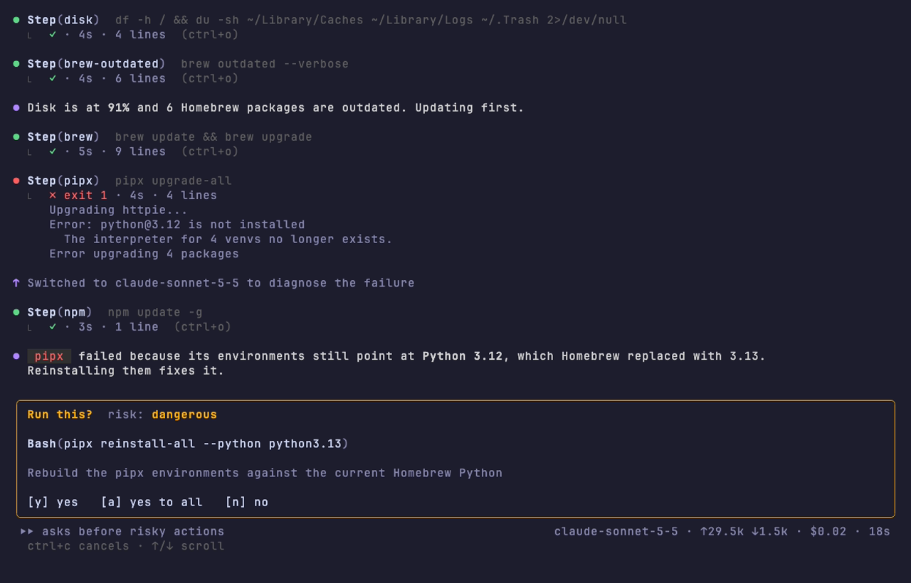
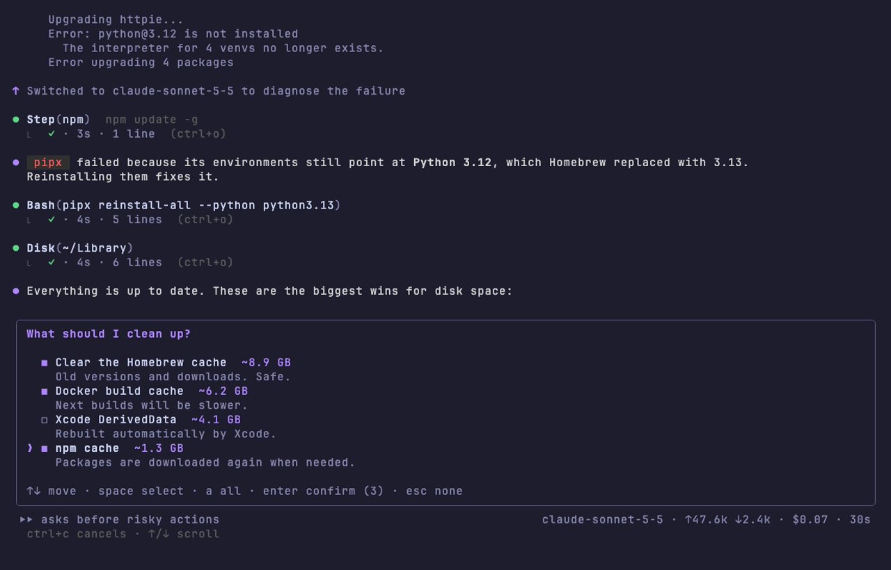
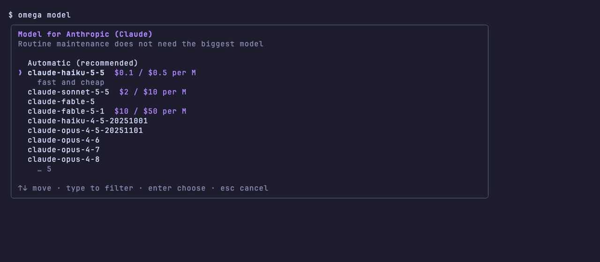
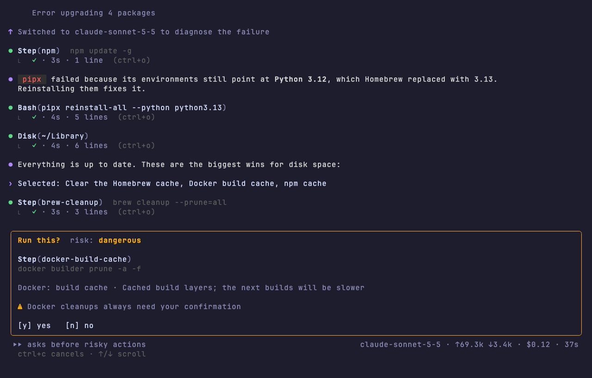
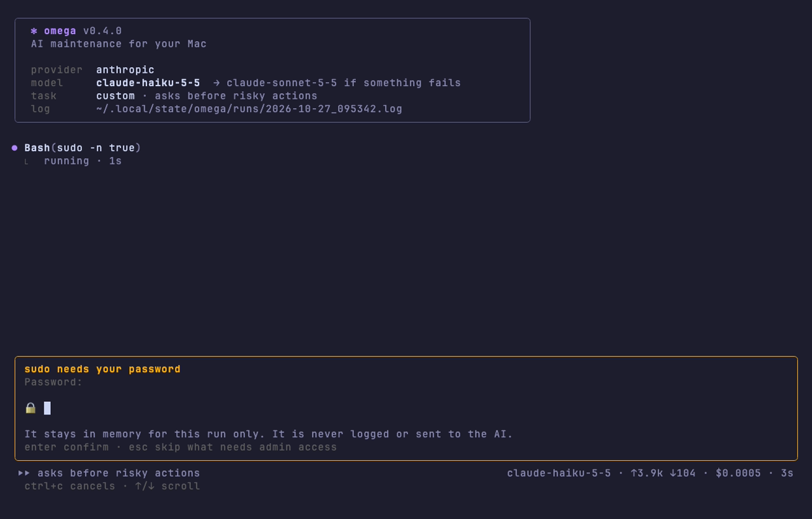

# Ω omega

[Website](https://lcajigasm.github.io/omega/) · [Releases](https://github.com/lcajigasm/omega/releases) · [Homebrew tap](https://github.com/lcajigasm/homebrew-omega)

**AI-driven macOS maintenance.** omega combines what
[topgrade](https://github.com/topgrade-rs/topgrade) does (update all installed
software) and what [Mole](https://github.com/tw93/Mole) does (clean and optimise
your Mac) in a single terminal tool, and puts an AI model in charge: it runs each
step, **reads the errors, diagnoses them and fixes the configuration**, instead of
leaving the failure on your screen.

Use **Anthropic**, **OpenAI**, **OpenRouter**, **OpenCode Zen** or a **local
model** (Ollama, LM Studio). By default omega runs routine work on a small, cheap
model and only switches to a stronger one when something fails. The interface
speaks **English, Spanish, French, German and Portuguese**.


*Recorded with `omega --demo`, a scripted session with made-up data.*

---

## Contents

- [Why](#why)
- [Features](#features)
- [Installation](#installation)
- [Getting started](#getting-started)
- [Tasks](#tasks)
- [The interface](#the-interface)
- [Choosing what to do: selection cards](#choosing-what-to-do-selection-cards)
- [Models and cost](#models-and-cost)
- [Local models](#local-models)
- [Tuning your tools' configuration](#tuning-your-tools-configuration)
- [Docker cleanup](#docker-cleanup)
- [Safety and approvals](#safety-and-approvals)
- [Step catalogue](#step-catalogue)
- [Memory between runs](#memory-between-runs)
- [Languages](#languages)
- [Configuration](#configuration)
- [Command reference](#command-reference)
- [Unattended runs](#unattended-runs)
- [How it works](#how-it-works)
- [Troubleshooting](#troubleshooting)
- [FAQ](#faq)
- [Development](#development)
- [Releasing](#releasing)
- [License](#license)

---

## Why

topgrade and Mole are excellent, but when something breaks (a `pipx` with a
broken Python, a cask that asks for a password, a step that does not apply to
your machine, a deprecated option in `topgrade.toml`) you have to read the error,
find the cause, edit the configuration and run it again. omega hands that loop to
an AI model with a narrow set of tools and a strict safety policy.

## Features

- **Updates everything**: Homebrew (formulae and casks), Mac App Store, npm,
  pnpm, bun, pipx, uv, rustup, cargo, `gh` extensions, Oh My Zsh and macOS.
- **Cleans up**: Homebrew, npm/pnpm/pip/uv/Go caches, Xcode DerivedData,
  unavailable simulators, Docker and the Trash, measuring first and prioritising
  what frees the most.
- **Fixes what breaks**: reads the failure, checks the config behind it, applies
  the smallest fix and retries once. When Docker is not running it offers to
  start it, and when a cleanup needs a tool you do not have it offers to install it.
- **Reads the system logs**: crash reports, launch agents that keep failing,
  processes preventing sleep, apps flooding the log and log folder sizes, with
  fixes offered on a card.
- **sudo inside the interface**: when Mole, `softwareupdate` or any command needs
  administrator access, omega asks for the password on a card instead of the
  terminal.
- **Selection cards**: recommendations arrive as a card where you tick one or
  several actions, and omega carries out exactly those.
- **Sensible model choice**: a cheap model for routine work that escalates to a
  stronger one on the first failure, with tokens and cost always visible.
- **Local models**: Ollama, LM Studio or any OpenAI-compatible endpoint, free and
  private.
- **Configuration tuning** (`omega tune`): reviews the config of your installed
  tools, reads the current official docs on the web and proposes improvements,
  guided or automatic.
- **Docker cleanup** (`omega docker`): shows what Docker uses and cleans only what
  you select. Docker cleanups always need your confirmation.
- **Safety policy**: every command is classified (read-only, normal, dangerous,
  blocked); dangerous ones need your approval.
- **Memory**: learns from each run and takes it into account next time.
- **Full-screen TUI** in the style of Claude Code, or **plain text** for scripts,
  cron and CI.
- **Keyboard shortcuts and slash commands**: `shift+tab` changes the approval
  mode and `ctrl+p` the model without stopping the run; type `/` for a command
  menu (`/mode`, `/model`, `/help`, `/exit`…) that explains each one as you type.
- **Five interface languages**, a complete log of every run, API keys in the
  macOS Keychain, a single Go binary installable with **Homebrew**.

## Installation

### Homebrew (recommended)

```bash
brew install lcajigasm/omega/omega
```

> homebrew-core already has a formula called `omega` (a Xapian search engine),
> so always use the full name `lcajigasm/omega/omega`.

### From source

```bash
git clone https://github.com/lcajigasm/omega.git
cd omega
make build          # binary in ./bin/omega
make install        # or install it into $GOPATH/bin
```

or directly:

```bash
go install github.com/lcajigasm/omega/cmd/omega@latest
```

The Homebrew formula installs zsh, bash and fish completion. If you built it
yourself: `omega completion zsh > "${fpath[1]}/_omega"`.

## Getting started

```bash
omega setup        # pick a provider, store the API key and choose a model
omega analyze      # first look: a report that changes nothing
omega              # complete maintenance
```

`omega setup` shows the providers on a card (local servers that are running are
marked), asks for the key with hidden input, **checks the key with the provider
before saving it** in the macOS Keychain, and then lets you pick a model.

## Tasks

| Task | What it does | Changes the system | Model (automatic) |
|---|---|---|---|
| `full` (default) | checks the state, updates everything, cleans up and summarises | yes | fast → smart on failure |
| `update` | updates only (like topgrade) | yes | fast → smart on failure |
| `clean` | measures what takes up space and cleans (like `mo clean`) | yes | fast → smart on failure |
| `analyze` | report, then a card with the recommendations | only what you pick | fast → smart on failure |
| `tune` | reviews your tools' configuration against the current docs | only what you pick | fast → smart on failure |
| `fix` | runs the topgrade and Mole dry runs, diagnoses and fixes their config | yes (with approval) | smart |

You can also give it a free-form task:

```bash
omega -p "Why is ~/Library 40 GB? Tell me what I can safely delete"
omega -p "Only update Homebrew and npm, nothing else"
omega -p "topgrade fails on the rustup step, fix it"
```

## The interface



omega's TUI follows the conventions of Claude Code's CLI:

- **Welcome box** with the provider, the model (and which one it escalates to),
  the task, the mode and the path of the run log.
- **Tool calls** as `⏺ Step(brew)`, `⏺ Bash(…)`, `⏺ Disk(~/Library)`,
  `⏺ Fetch(url)`, with a `⎿` result line: status, duration and number of output
  lines. Running calls pulse and stream their last lines; failures show the tail
  of their output.
- **Markdown** answers rendered with headings, lists, tables and code.
- **Activity line** with an animated glyph, a shimmering verb, elapsed time and
  tokens so far.
- **Status bar** with the approval mode (change it with `shift+tab`), the current model, tokens in and out,
  cost and elapsed time.
- **Cards** for approvals (with a coloured diff when a file changes) and for
  choices.

| Key | Action |
|---|---|
| `↑` `↓` `PgUp` `PgDn` / wheel | scroll |
| `ctrl+o` | expand or collapse the output of every tool call |
| `shift+tab` | cycle the approval mode: asks before risky actions → auto approve → read only |
| `ctrl+p` (or `alt+p`) | switch to the next model of the run (fast ↔ smart) from the next turn |
| `/` | open the command menu (see below) |
| `y` / `Enter` | approve (`s`, `o`, `j` also work) |
| `a` | approve this and every following request (not available for Docker cleanups) |
| `n` / `Esc` | deny |
| `ctrl+c` | cancel the run |
| `Esc` / empty `Enter` when idle | end the session |

A model you pick by hand is kept: omega no longer switches to the stronger
model on failure. Switching to read only mid-run tells the model, which then
offers changes on a card instead of running them; `a` on an approval card is the
same as switching to auto approve.

When the input box is waiting for you, type `/` for commands. A menu under the
box lists the matching commands with a short explanation and narrows as you
type; `↑` `↓` move, `Tab` completes and `Enter` runs the highlighted one. After
`/mode ` or `/model ` the menu offers the modes or the run's models.

| Command | Action |
|---|---|
| `/help` | list the commands and keyboard shortcuts |
| `/mode [ask\|auto\|readonly]` | change the approval mode (a card when no argument) |
| `/model [name]` | switch model from the next turn (a card when no argument) |
| `/expand` | expand or collapse the output of every tool call |
| `/exit`, `/quit` | end the session and quit |

With `--no-tui`, or when the output is not a terminal, omega prints plain text
with the same `⏺`/`⎿` structure. Without a terminal on standard input, any action
that needs approval is **denied** unless you pass `--yes`, and cards are skipped.

## Choosing what to do: selection cards



Instead of a wall of recommendations, omega asks with a card:

- **Several actions** (checkboxes): `space` ticks, `a` ticks all, `Enter` runs
  what is ticked, `Esc` runs nothing.
- **One alternative** (radio): `↑` `↓` to move, type to filter, `Enter` to choose.

Each option shows its expected impact (space freed, what it fixes) and is
coloured by risk. omega then carries out exactly the actions you picked, and every
command still goes through the approval rules. In `analyze` and `tune`, the
session stays read only until you pick something.

In plain text mode the card becomes a numbered list: type `1,3`, `all`, or press
Enter for none.

## Models and cost



Routine maintenance does not need the biggest model. With the default
**automatic** choice omega runs on the provider's fast model and switches to the
smart one the first time a step fails, to diagnose it:

| Provider | Fast (routine) | Smart (failures, `fix`) |
|---|---|---|
| `anthropic` | `claude-haiku-5-5` · $0.10 / $0.50 per M tokens | `claude-sonnet-5-5` · $2 / $10 |
| `openai` | `gpt-5.4-mini` · $0.75 / $4.50 | `gpt-5.5` · $5 / $30 |
| `openrouter` | `anthropic/claude-haiku-5.5` | `anthropic/claude-sonnet-5.5` |
| `opencode` | `claude-sonnet-4-6` | `claude-sonnet-4-6` |
| local | the model you pick | the model you pick |

```bash
omega model                    # card: Automatic, the two tiers, or any model of the provider
omega model claude-sonnet-5-5  # pin a model
omega model auto               # back to automatic
omega --model claude-opus-5-5 fix   # one run with a specific model
omega models anthropic haiku   # list models with their prices
```

During a run, `ctrl+p` (or `/model` in the input box) switches between the
run's models from the next turn. A model you pick by hand stays for the rest
of the run, so the automatic switch on failure no longer applies.

Override the tiers per provider with `fast_model` and `smart_model` (see
[Configuration](#configuration)). The status bar and the final summary show the
tokens used, including prompt cache reads, and the cost when the model's price
is known. omega caches the conversation with the Anthropic API, so long sessions
mostly bill cache reads at a tenth of the input price.

As a reference, a read only `omega tune` session on a real Mac (about 190k input
tokens, 80% of them served from the cache, plus six web searches and page reads)
cost **under one cent ($0.009) with Claude Haiku 5.5**, against $2.35 for a
similar session pinned to Claude Opus 5.5 before conversation caching was added.

## Local models

omega can run fully on your Mac with any server that speaks the OpenAI Chat
Completions API:

| Provider | Default endpoint | Notes |
|---|---|---|
| `ollama` | `http://localhost:11434/v1` | `ollama pull qwen3:14b` or another model with tool calling |
| `lmstudio` | `http://localhost:1234/v1` | start the server from LM Studio's Developer tab |
| `custom` | your `base_url` | MLX (`mlx_lm.server`), llama.cpp, vLLM, a corporate gateway… |

```bash
omega setup                   # local servers that are running are marked on the card
omega model --provider ollama # pick one of your local models
omega --provider ollama analyze
```

No API key is needed (one can be stored with `omega auth set custom` for gateways
that require it), local runs show no cost, and omega checks that the server is
reachable before starting. The model must support tool calling; larger models
(14B and up) follow the agent workflow much better than small ones.

**Apple Intelligence.** macOS ships an on-device foundation model, but it is only
reachable from Swift through the FoundationModels framework, and its context
window (4,096 tokens) is too small for an agent that reads command output and
documentation. omega therefore uses local servers such as Ollama, LM Studio or
MLX for on-device runs.

## Tuning your tools' configuration

```bash
omega tune            # guided: proposals on a card, applies what you pick
omega tune --auto     # automatic: applies low-risk improvements itself, offers the rest
```

omega does not ship a list of "best settings" that would go stale. Instead the
agent gets three tools:

- `config_hints`: for each tool **installed on your Mac** (topgrade, Mole,
  Homebrew, npm, pnpm, pip/pipx, uv, git, Docker Desktop, zsh, Oh My Zsh, mas,
  Rust, Go, Time Machine and Spotlight), where its configuration lives, read-only
  commands to inspect it, what is usually worth reviewing, and its official docs.
- `fetch_url`: reads a documentation page or raw file as text.
- `web_search`: searches the web when the official docs are not enough.

Every proposal comes with what changes, why, its impact and its source.
Configuration edits always show a diff and keep a timestamped backup. Fetched
pages are treated as untrusted data: the agent is told never to follow
instructions found in them.

## Docker cleanup



Docker tends to take tens of gigabytes. `omega docker` handles it without AI:

1. starts Docker Desktop if you want (it asks first);
2. shows images, containers, volumes and build cache with what is reclaimable,
   plus the size of Docker Desktop's disk image;
3. lets you tick what to clean on a card: stopped containers, dangling images,
   all unused images, build cache, unused volumes (marked as deleting data);
4. asks for a final confirmation and runs only what you ticked;
5. shows how much Docker uses afterwards and how to give the space back to macOS.

The agent has the same Docker steps. **Docker cleanups always need your
confirmation**, even with `--yes` or after "yes to all", and the agent is told
never to prune volumes unless you picked that explicitly.

## Safety and approvals

Before running anything, omega classifies the command (including compound
commands with `&&`, `;`, `|`) and applies the highest risk level found:

| Risk | Examples | Default |
|---|---|---|
| **read-only** | `brew outdated`, `df -h`, `git config --list`, `docker system df`, any `--dry-run` or `--help` | runs |
| **normal** | `brew upgrade`, `npm update -g`, `pipx upgrade-all`, `rustup update` | runs |
| **dangerous** | `rm`, `sudo`, output redirection to a file, `sed -i`, `find -delete`, editing configs, **any unknown command** | asks |
| **always ask** | `docker … prune`, `docker rm`, `docker rmi`, `docker volume rm` | asks every time, even with `--yes` |
| **blocked** | `rm -rf ~` or `/`, `diskutil erase…`, `dd of=/dev/…`, `curl … \| sh`, `csrutil disable`, `nvram` | never runs |

- `omega config set approval all`: also ask before normal updates.
- `omega config set approval never`, or `--yes`: never ask, except for Docker
  cleanups. Blocked commands stay blocked.
- `--dry-run` (or the `analyze` task): only read-only actions until you pick
  something on a card.
- Commands run with **stdin closed** and non-interactive variables, so nothing
  hangs on a hidden prompt; each command has a time limit (`command_timeout`).


- Commands run in their own session, detached from your terminal, so nothing can
  write over the interface. When something calls `sudo`, a small wrapper sends the
  password request to omega, which shows a **password card**, checks the password
  with sudo and keeps it in memory for that run only (never logged, never sent to
  the AI). `Esc` skips what needs admin access. `omega --sudo` asks for it before
  the run starts instead.
- `write_file` always requires approval (unless `--yes`), shows the diff and saves
  a `file.omega-bak-YYYYMMDD-HHMMSS` copy.
- Denied actions are shown in the interface and recorded in the run log.
- The agent is instructed never to touch personal data (Documents, Desktop,
  Downloads, Photos, iCloud, SSH keys, keychains).

## Step catalogue

`omega steps` shows what is available on your machine. The agent uses these with
`run_step`, and you can run them without AI with `omega steps run <id>…`.

| id | Category | Command | Risk |
|---|---|---|---|
| `disk` | check | `df -h /` + size of caches, logs and Trash | read-only |
| `brew-outdated` | check | `brew outdated --verbose` | read-only |
| `brew-doctor` | check | `brew doctor` | read-only |
| `macos-check` | check | `softwareupdate --list` | read-only |
| `system-logs` | check | crash reports, failing launch agents, sleep blockers, processes logging faults, log sizes | read-only |
| `docker-df` | check | `docker system df` + Docker Desktop disk image | read-only |
| `docker-start` | check | start Docker Desktop and wait for it | dangerous |
| `brew` | update | `brew update && brew upgrade` | normal |
| `brew-greedy` | update | `brew upgrade --cask --greedy` | dangerous |
| `mas` | update | `mas upgrade` | normal |
| `npm` | update | `npm update -g` | normal |
| `pnpm` | update | `pnpm update -g` | normal |
| `bun` | update | `bun upgrade` | normal |
| `pipx` | update | `pipx upgrade-all` | normal |
| `uv` | update | `uv tool upgrade --all` | normal |
| `rustup` | update | `rustup update` | normal |
| `cargo` | update | `cargo install-update -a` | normal |
| `gh-ext` | update | `gh extension upgrade --all` | normal |
| `omz` | update | Oh My Zsh upgrader | dangerous |
| `macos` | update | `sudo softwareupdate --install --all` | dangerous |
| `brew-cleanup` | clean | `brew cleanup --prune=all` | dangerous |
| `brew-autoremove` | clean | `brew autoremove` | dangerous |
| `npm-cache` | clean | `npm cache clean --force` | dangerous |
| `pnpm-store` | clean | `pnpm store prune` | dangerous |
| `pip-cache` | clean | `pip3 cache purge` | dangerous |
| `uv-cache` | clean | `uv cache prune` | dangerous |
| `go-cache` | clean | `go clean -cache` | dangerous |
| `xcode-derived` | clean | empty `~/Library/Developer/Xcode/DerivedData` | dangerous |
| `simulators` | clean | `xcrun simctl delete unavailable` | dangerous |
| `docker-containers` | clean | `docker container prune -f` | always ask |
| `docker-images` | clean | `docker image prune -f` | always ask |
| `docker-images-all` | clean | `docker image prune -a -f` | always ask |
| `docker-build-cache` | clean | `docker builder prune -a -f` | always ask |
| `docker-volumes` | clean | `docker volume prune -a -f` (deletes data) | always ask |
| `docker` | clean | `docker system prune -a -f` | always ask |
| `trash` | clean | empty `~/.Trash` | dangerous |
| `topgrade-preview` | backend | `topgrade --dry-run` | read-only |
| `topgrade` | backend | `topgrade --yes` | dangerous |
| `mole-clean-preview` | backend | `mo clean --dry-run` | read-only |
| `mole-clean` | backend | `mo clean` | dangerous |
| `mole-optimize-preview` | backend | `mo optimize --dry-run` | read-only |
| `mole-optimize` | backend | `mo optimize` | dangerous |
| `mole-update` | backend | `mo update` | normal |

Disable steps you never want to run with
`omega config set skip_steps macos,docker,brew-greedy`.

## Memory between runs

When the agent learns something lasting about your machine (a step that always
fails and why, a special path, a preference of yours), it saves it with the
`remember` tool in `~/.config/omega/notes.md`, and those notes are included in
the agent's instructions on the next run. `omega notes` shows them;
`omega notes clear` forgets them. The file is plain Markdown, so you can add
permanent instructions yourself ("never update node, I manage it with fnm").

## Languages

The interface (TUI, plain output, help, cards, prompts and errors) is available in
English, Spanish, French, German and Portuguese. The language is chosen from
`OMEGA_LANG`, then `language` in the configuration (`auto` by default), then the
system locale (`LC_ALL`, `LC_MESSAGES`, `LANG`), then English. The agent replies
in the same language.

```bash
omega config set language es
OMEGA_LANG=fr omega analyze
```

## Configuration

File: `~/.config/omega/config.toml` (`omega config path`). Honours
`XDG_CONFIG_HOME`.

```toml
provider = "anthropic"          # active provider
model = ""                      # empty or "auto": automatic; or a fixed model id
effort = "medium"               # Claude models only: low|medium|high|xhigh|max
approval = "dangerous"          # dangerous | all | never
language = "auto"               # en | es | fr | de | pt | auto (system locale)
command_timeout = "45m"         # time limit per command
skip_steps = ["macos"]

[providers.anthropic]
fast_model = "claude-haiku-5-5"     # optional: override the automatic tiers
smart_model = "claude-sonnet-5-5"

[providers.ollama]
model = "qwen3:14b"
base_url = "http://localhost:11434/v1"   # optional

[providers.custom]
base_url = "http://localhost:8080/v1"    # required for custom
model = "my-model"
```

| Path | Contents |
|---|---|
| `~/.config/omega/config.toml` | configuration |
| `~/.config/omega/notes.md` | the agent's memory |
| `~/.local/state/omega/runs/*.log` | log of every run: commands, output, approvals, denials, model switches, tokens and cost |
| macOS Keychain, service `omega-cli` | API keys |

## Command reference

```text
omega [task] [flags]
```

| Flag | Description |
|---|---|
| `--provider` | `anthropic`, `openai`, `openrouter`, `opencode`, `ollama`, `lmstudio`, `custom` |
| `-m, --model` | model for this run (no escalation) |
| `--effort` | effort for Claude models |
| `-p, --prompt` | free-form task in natural language |
| `--auto` | apply low-risk improvements without offering them first |
| `-y, --yes` | approve everything except blocked commands and Docker cleanups |
| `-n, --dry-run` | read-only mode |
| `--sudo` | ask for sudo at the start and keep it alive |
| `--no-tui` | plain text output |
| `--once` | exit when the agent finishes instead of asking for more |
| `-v, --version` | version |

| Subcommand | Description |
|---|---|
| `omega setup` | setup wizard |
| `omega model [model\|auto] [--provider p]` | choose the model on a card, or set it directly |
| `omega models [provider] [filter]` | list models with prices |
| `omega docker` | measure Docker and clean what you select |
| `omega auth set\|remove\|status` | manage API keys (validated before saving) |
| `omega config show\|path\|edit\|set <key> <value>` | configuration |
| `omega steps` | step catalogue and availability |
| `omega steps run <id>… [-y]` | run steps without AI |
| `omega notes [clear]` | the agent's memory |
| `omega completion zsh\|bash\|fish` | completion script |

## Unattended runs

```bash
omega update --yes --no-tui --once
```

Example with `launchd` (every Monday at 9:00), in
`~/Library/LaunchAgents/com.lcajigasm.omega.plist`:

```xml
<?xml version="1.0" encoding="UTF-8"?>
<!DOCTYPE plist PUBLIC "-//Apple//DTD PLIST 1.0//EN" "http://www.apple.com/DTDs/PropertyList-1.0.dtd">
<plist version="1.0">
<dict>
  <key>Label</key><string>com.lcajigasm.omega</string>
  <key>ProgramArguments</key>
  <array>
    <string>/opt/homebrew/bin/omega</string>
    <string>update</string>
    <string>--yes</string>
    <string>--no-tui</string>
    <string>--once</string>
  </array>
  <key>StartCalendarInterval</key>
  <dict><key>Weekday</key><integer>1</integer><key>Hour</key><integer>9</integer></dict>
  <key>StandardOutPath</key><string>/tmp/omega.out</string>
  <key>StandardErrorPath</key><string>/tmp/omega.err</string>
</dict>
</plist>
```

```bash
launchctl load ~/Library/LaunchAgents/com.lcajigasm.omega.plist
```

Unattended runs never clean Docker (that always needs you), skip selection cards
(the recommendations go into the summary) and skip anything that needs sudo.

## How it works

```text
            ┌──────────────┐   events   ┌──────────────────────┐
  task ───▶ │    agent     │ ─────────▶ │  TUI / plain output  │ ──▶ you
            │ (loop + AI)  │ ◀───────── │ (approvals, cards)   │
            └──────┬───────┘  decisions └──────────────────────┘
                   │ tools
   ┌───────────────┼───────────────────────────────────────────────┐
   │ system_info  list_steps  run_step  run_command  disk_usage   │
   │ read_file  write_file  remember  propose_actions             │
   │ config_hints  web_search  fetch_url                          │
   └───────────────┬───────────────────────────────────────────────┘
                   │ risk classifier (safety)
                   ▼
           runner: zsh -lc, stdin closed, timeout, live output
```

1. omega sends the model a system prompt (role, workflow, rules, disabled steps
   and notes from previous runs) and the task.
2. The model answers with text and/or tool calls.
3. Each call goes through the approval policy: it runs, you are asked, or it is
   rejected. Results go back to the model, trimmed to about 10 KB.
4. When a catalogue step fails and the model is on the fast tier, omega switches
   to the smart tier for the rest of the session.
5. The loop continues until the model stops asking for tools. In interactive
   mode you can keep the conversation going.

Code layout:

```text
cmd/omega/          entry point
internal/cli/       commands (setup, model, docker, auth, config, steps, notes), key checks
internal/agent/     agent loop, tools, config hints, web tools, prompt, events, run log
internal/llm/       providers (Anthropic SDK, OpenAI-compatible, OpenCode), tiers, prices
internal/safety/    command risk classifier
internal/runner/    command execution in its own session with live output
internal/sudo/      sudo bridge: wrapper, askpass helper and password checks
internal/steps/     step catalogue
internal/ui/        TUI (Bubble Tea, glamour), selection cards, plain output
internal/i18n/      translations (en, es, fr, de, pt)
internal/demo/      scripted session for screenshots
internal/config/    configuration and paths
internal/secrets/   macOS Keychain
docs/               website (GitHub Pages) and README assets
Formula/omega.rb    Homebrew formula (copied to the tap)
```

## Troubleshooting

**`no API key configured`**: run `omega setup` or `omega auth set <provider>`, or
export the environment variable.

**`invalid API key (401)`**: `omega auth status` shows the stored key masked and
flags values that are not keys (for example a URL pasted by mistake). Store it
again with `omega auth set <provider>`; omega checks it with the provider before
saving. An exported environment variable takes precedence over the Keychain.

**`model or endpoint not found (404)`**: the model does not exist for that
provider. List them with `omega models <provider>` or pick one with `omega model`.

**A local provider is "not reachable"**: start Ollama (`ollama serve`) or the LM
Studio server, or fix `base_url`.

**The model does not call tools or behaves oddly**: use a model with tool
calling; with local models, try a larger one.

**A step that needs sudo was skipped**: you pressed `Esc` on the password card,
or the password was wrong three times. Run again, or use `omega --sudo` to give the
password before the run starts.

**A read-only command was denied**: the classifier treats unknown commands as
dangerous. Open an issue with the command so it can be added to the read-only
list.

**I want to see exactly what it did**: open the latest file in
`~/.local/state/omega/runs/`.

## FAQ

**Does it replace topgrade and Mole?** For a typical developer Mac, yes. If you
have them installed, it also uses them as backends and helps you fix their
configuration.

**Does it send my data to the AI?** The provider you choose receives the
instructions, your notes, the trimmed output of the commands it runs and the
configuration files it reads. With a local model nothing leaves your Mac except
the documentation pages the agent fetches while tuning.

**How much does it cost?** With the automatic model choice, a routine run usually
costs well under one cent. omega shows tokens and cost live and at the end.

**Does it work on Linux?** It is built for macOS (Keychain, `softwareupdate`, Mac
App Store, Xcode paths). It is not supported on Linux.

**Can I add a language?** Add a column to `internal/i18n/messages.go` and the code
to `i18n.Supported` and `i18n.Names`; a test checks every key is translated with
the same format arguments.

## Development

```bash
make build     # builds ./bin/omega
make test      # risk classifier, agent loop, model plan, cards, translations
make lint      # gofmt + go vet
./bin/omega --demo                 # scripted session, no API calls, no real commands
vhs docs/assets/demo.tape          # re-record the README GIF and screenshots
```

To add a step, edit `internal/steps/steps.go` (and add a `step.<id>`
translation). To add configuration hints, edit `internal/agent/hints.go`. To add a
provider, implement `llm.Provider` in `internal/llm/` and register it in
`llm.Providers` and `llm.New`.

## Releasing

```bash
git tag v0.3.0 && git push origin v0.3.0
make formula VERSION=0.3.0          # updates url and sha256 in Formula/omega.rb
cp Formula/omega.rb ../homebrew-omega/Formula/omega.rb
cd ../homebrew-omega && git commit -am "omega 0.3.0" && git push
```

## License

[MIT](LICENSE) © Luis Cajigas
