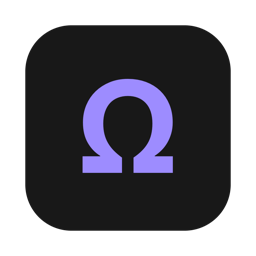
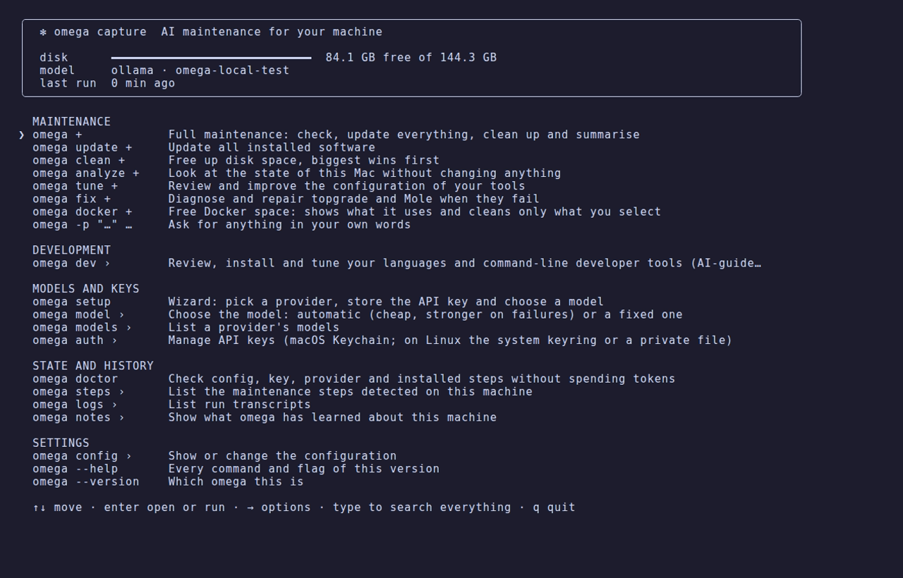
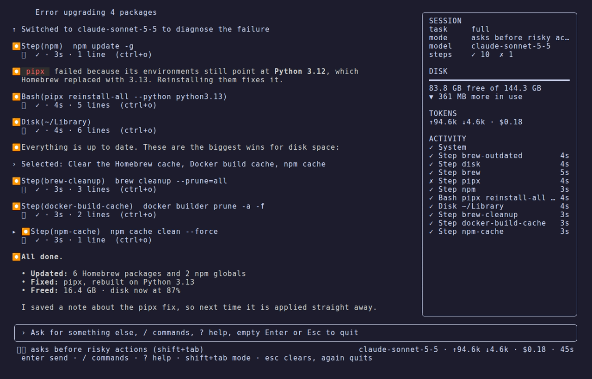
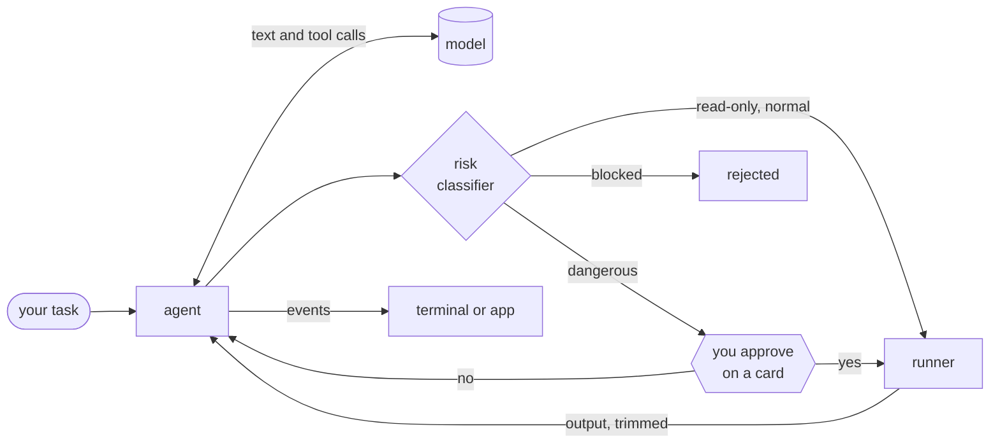
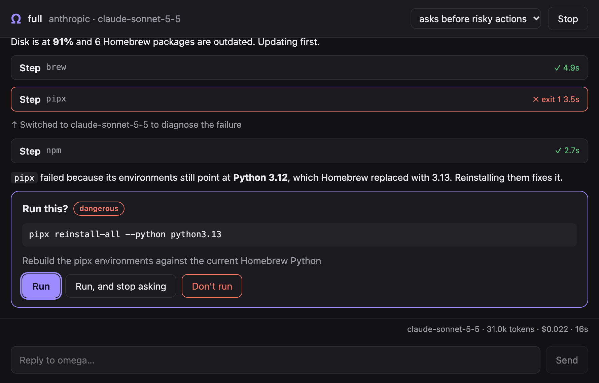
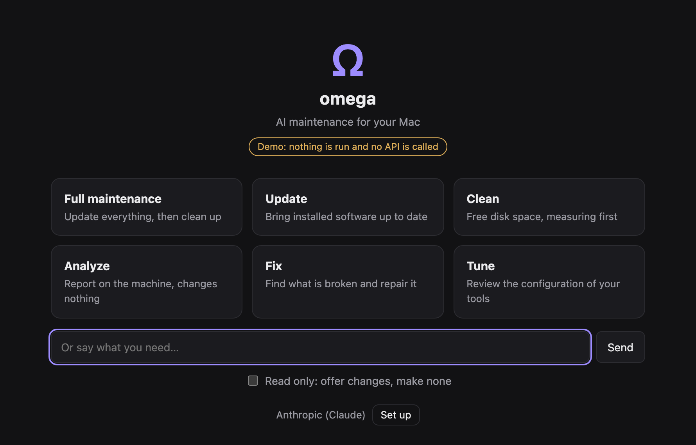

<div align="center">



# omega

**AI-driven maintenance for macOS, Linux and Windows.**

Updates like [topgrade](https://github.com/topgrade-rs/topgrade), cleans like
[Mole](https://github.com/tw93/Mole), and when a step fails it reads the error,
finds the cause and fixes it.

[](https://github.com/lcajigasm/omega/releases/latest)
[](https://github.com/lcajigasm/omega/actions/workflows/ci.yml)
[](LICENSE)
[](go.mod)


[**Website**](https://lcajigasm.github.io/omega/) ·
[**Manual**](docs/manual/README.md) ·
[**Releases**](https://github.com/lcajigasm/omega/releases) ·
[**Homebrew tap**](https://github.com/lcajigasm/homebrew-tap)

<br>


<sub>Recorded from the <code>omega</code> binary (<code>omega --demo</code>) by <code>scripts/capture.sh</code>.</sub>

</div>

## Quick start

```bash
brew install lcajigasm/tap/omega   # macOS, and Linux with Homebrew
omega setup                        # pick a provider and store its key
omega analyze                      # a first report that changes nothing
omega                              # the maintenance: update, clean, summarise
```

Prefer a window? `brew install --cask lcajigasm/tap/omega-app` installs the
[desktop app](#desktop-app) on a Mac; Windows and Linux builds are on the
release page.

> [!TIP]
> `omega analyze` is read only. You see what omega would do before you let it
> do anything, and nothing changes until you tick it on a card.

<details>
<summary><b>Windows 10 and 11</b></summary>

<br>

Take the zip for amd64 or arm64 from the
[latest release](https://github.com/lcajigasm/omega/releases/latest), then in
PowerShell:

```powershell
Expand-Archive omega_*_windows_amd64.zip -DestinationPath "$env:LOCALAPPDATA\Programs\omega"
$dir = "$env:LOCALAPPDATA\Programs\omega"
[Environment]::SetEnvironmentVariable("Path", [Environment]::GetEnvironmentVariable("Path", "User") + ";$dir", "User")
```

Open a new terminal and run `omega setup`. Windows Terminal is recommended.

</details>

<details>
<summary><b>Linux without Homebrew</b></summary>

<br>

```bash
tar -xzf omega_*_linux_amd64.tar.gz        # or linux_arm64
sha256sum -c SHA256SUMS --ignore-missing   # with SHA256SUMS downloaded next to it
sudo install -m 755 omega /usr/local/bin/omega
```

</details>

<details>
<summary><b>Container image</b></summary>

<br>

```bash
docker run --rm -it ghcr.io/lcajigasm/omega --demo                         # a scripted session, nothing real
docker run --rm -it -e ANTHROPIC_API_KEY ghcr.io/lcajigasm/omega analyze   # inside the container
```

For trying omega or for a pipeline: in a container it looks after the
container, not the machine running Docker. More in
[Install and set up](docs/manual/install.md#container-image).

</details>

<details>
<summary><b>From source</b></summary>

<br>

```bash
go install github.com/lcajigasm/omega/cmd/omega@latest
```

</details>

> [!NOTE]
> homebrew-core already has a formula called `omega` (a Xapian search engine),
> so always install with the full name, `lcajigasm/tap/omega`. More in
> [Install and set up](docs/manual/install.md).

## Why

topgrade and Mole are excellent until something breaks. Then the work is yours.

| | Running topgrade and Mole by hand | Running omega |
|---|---|---|
| **A step fails** | The run moves on with a red line you scroll back to | It reads the failure the moment it happens and works out the cause |
| **The fix** | You search the error, edit `topgrade.toml` and launch everything again | It applies the smallest fix, retries once and moves on if it still fails |
| **A password prompt** | The run hangs halfway, waiting on a prompt | Commands run without a prompt; sudo asks on a card inside the interface |
| **Next month** | The same `pipx` failure comes back | It wrote down what it learned and starts there |

## What it does

| | Command | What you get |
|---|---|---|
| **Everything** | `omega` | Checks the state, updates, cleans up and tells you what changed |
| **A guided run** | `omega full` | Every stage that applies to this machine, on one screen, with a plan you can edit |
| **Update** | `omega update` | Homebrew, the App Store, apt, dnf, pacman, winget, Scoop, npm, pnpm, pipx, uv, rustup, cargo and more |
| **Clean** | `omega clean` | Measures first, then frees what is worth it: package caches, Xcode, Docker, the Trash |
| **Report** | `omega analyze` | Disk, outdated software and config problems, then a card with recommendations |
| **Health** | `omega health` | Disk and battery health, memory, backups, firewall, encryption and the system logs |
| **Repair** | `omega fix` | Runs the topgrade and Mole dry runs, diagnoses their configuration and fixes it |
| **Tune** | `omega tune` | Reviews your tools' configuration against their current documentation |
| **Developer setup** | `omega dev` | More than 70 languages, version managers and tools: what is installed, what overlaps, what is broken |
| **Docker** | `omega docker` | Shows what Docker uses and removes only what you select. It always asks |
| **Your Mac** | `omega mac` | Login and background items, the menu bar, the Dock, shortcut conflicts, stale privacy permissions |
| **Anything else** | `omega -p "…"` | Say it in words; the agent has the same tools |

`omega menu` lists all of it on one screen. Each row is explained in
[Tasks and the guided run](docs/manual/tasks.md).

## See it

<table>
<tr>
<td width="50%">

<br><sub><b>Failures get fixed.</b> The failure is diagnosed on a stronger model, and the fix waits for your approval.</sub>
</td>
<td width="50%">

<br><sub><b>You pick, it does.</b> Recommendations arrive on a card. omega carries out exactly what you tick.</sub>
</td>
</tr>
<tr>
<td>

<br><sub><b>One home screen.</b> Every command, grouped by area. Type to search, Enter to run.</sub>
</td>
<td>

<br><sub><b>A summary you can trust.</b> What was updated, what was freed, what failed and what it cost.</sub>
</td>
</tr>
</table>

The interface, its shortcuts and its slash commands are in
[The interface](docs/manual/interface.md).

## Three systems, each with its own steps

The agent is the same everywhere. What it runs is what the system has.

| | macOS | Linux | Windows |
|---|---|---|---|
| **Packages** | Homebrew formulae and casks, Mac App Store | apt, dnf, pacman, zypper, Flatpak, snap, Homebrew | winget, Scoop, Chocolatey |
| **System** | `softwareupdate`, system logs, Xcode, simulators | journal, firmware, pending restarts | Windows Update, event log, component store, Defender signatures |
| **Cleanup** | Caches, DerivedData, the Trash, optionally Mole | Package caches, old snap revisions, unused Flatpak runtimes | Temporary files, the Recycle Bin |
| **API keys** | Keychain | Secret Service, or a file only you can read | Credential Manager |
| **Only here** | `omega mac`: what runs outside the apps you open | Names the distribution it runs on | Commands run in PowerShell |
| **Details** | [Your Mac](docs/manual/mac.md) | [Linux](docs/manual/linux.md) | [Windows](docs/manual/windows.md) |

npm, pnpm, bun, pipx, uv, rustup, cargo, `gh` extensions and Docker are covered
on all three. `omega steps` prints the catalogue for the machine you are on.

## Nothing risky runs without you

Every command is classified before it runs, including each part of a compound
command. The highest risk found decides.

| Risk | Examples | What happens |
|---|---|---|
| 🟢 **read-only** | `brew outdated`, `df -h`, any `--dry-run` | runs |
| 🟡 **normal** | `brew upgrade`, `npm update -g`, `rustup update` | runs |
| 🟠 **dangerous** | `rm`, `sudo`, editing a config, **any unknown command** | asks you |
| 🔴 **always ask** | `docker … prune`, `docker volume rm` | asks every time, even with `--yes` |
| ⛔ **blocked** | `rm -rf ~`, `curl … \| sh`, `dd of=/dev/…`, reading a private key | never runs |



API keys never reach the commands omega runs, and the agent cannot read them.
The full policy is in
[Safety, approvals and memory](docs/manual/safety.md), and how the loop works
in [How it works](docs/manual/development.md).

## The model you trust, at the size the job needs

Routine work runs on a small, cheap model. On the first failure omega switches
to a stronger one for the rest of the session. Which two is decided once a day
from current list prices and benchmark scores, not from a list built into the
program, and tokens and cost are always on screen.

| Provider | |
|---|---|
| **Anthropic** | Official Go SDK with conversation caching |
| **OpenAI** | Chat Completions with tool calling |
| **OpenRouter** | Hundreds of models behind one key |
| **OpenCode Zen** | Claude, Qwen, GLM, Kimi and more |
| **Ollama, LM Studio** | Local and free |
| **Any compatible endpoint** | MLX, llama.cpp, vLLM or a company gateway through a base URL |

`omega models` shows the ranking, `omega model` fixes one.
[Models and cost](docs/manual/models.md) has the rest.

## Local models

Ollama, LM Studio or any OpenAI-compatible endpoint work with no key and no
cost, and nothing leaves your machine but the documentation omega reads.
`omega setup` marks the local servers that are running. For an endpoint of your
own, choose **OpenAI-compatible endpoint** and give it the base URL, for
example `http://localhost:8080/v1`. What to expect from a local model is in
[Local models](docs/manual/models.md#local-models).

## Desktop app

The same agent in a window, for when a terminal is not where you want to be:
the same tasks, safety policy, configuration and keys as the command.

<table>
<tr>
<td width="50%">

<br><sub>Steps as they finish, and the fix waiting for your approval.</sub>
</td>
<td width="50%">

<br><sub>Pick a task, or say what you need in words.</sub>
</td>
</tr>
</table>

```bash
brew install --cask lcajigasm/tap/omega-app             # macOS 13 or later
xattr -dr com.apple.quarantine /Applications/Omega.app   # once: the app is not notarized yet
```

| System | Download | Then |
|---|---|---|
| macOS, Apple Silicon and Intel | [`omega-macos-universal.dmg`](https://github.com/lcajigasm/omega/releases/latest/download/omega-macos-universal.dmg) | drag Omega to Applications and run the `xattr` line above |
| Windows 10 and 11 | `omega-gui_<version>_windows_amd64.zip` or `arm64`, from the [latest release](https://github.com/lcajigasm/omega/releases/latest) | extract it and open `omega-gui.exe`; SmartScreen warns once: More info, then Run anyway |
| Linux | `omega-gui_<version>_linux_amd64.tar.gz` or `arm64`, from the [latest release](https://github.com/lcajigasm/omega/releases/latest) | extract it and run `./omega-gui`; it needs GTK 4 and WebKitGTK 6.0 |

The app and the command are separate installs that share their configuration
and API keys: have both, or only one. More in
[Install and set up](docs/manual/install.md#desktop-app).

## Also

- **Speaks five languages**: English, Spanish, French, German and Portuguese,
  in the command, in the app and on the [website](https://lcajigasm.github.io/omega/).
- **Remembers**: it learns from each run and starts there next time.
- **Runs unattended**: plain output for scripts, cron, launchd and CI
  ([how](docs/manual/tasks.md#unattended-runs)).
- **Keeps a log** of every run, which `omega logs` reads back.
- **One Go binary**, MIT licensed.

## Manual

| | |
|---|---|
| [Install and set up](docs/manual/install.md) | [Tasks and the guided run](docs/manual/tasks.md) |
| [The interface](docs/manual/interface.md) | [Models and cost](docs/manual/models.md) |
| [Your tools: tune, dev, Docker](docs/manual/tools.md) | [Your Mac](docs/manual/mac.md) |
| [Linux](docs/manual/linux.md) | [Windows](docs/manual/windows.md) |
| [Safety, approvals and memory](docs/manual/safety.md) | [Reference: steps, configuration, commands](docs/manual/reference.md) |
| [Troubleshooting and FAQ](docs/manual/help.md) | [How it works, development and releasing](docs/manual/development.md) |

`omega doctor` checks your setup and says when a newer release exists.

## Contributing

```bash
make build     # ./bin/omega
make test      # go test ./...
make lint      # gofmt and go vet
./bin/omega --demo                 # a scripted session: no API calls, no real commands
```

Captures in this README and on the website are recordings of the real
binaries, never drawings: see [CONTRIBUTING.md](CONTRIBUTING.md). The code
layout and the release process are in
[How it works, development and releasing](docs/manual/development.md).

## License

[MIT](LICENSE)
