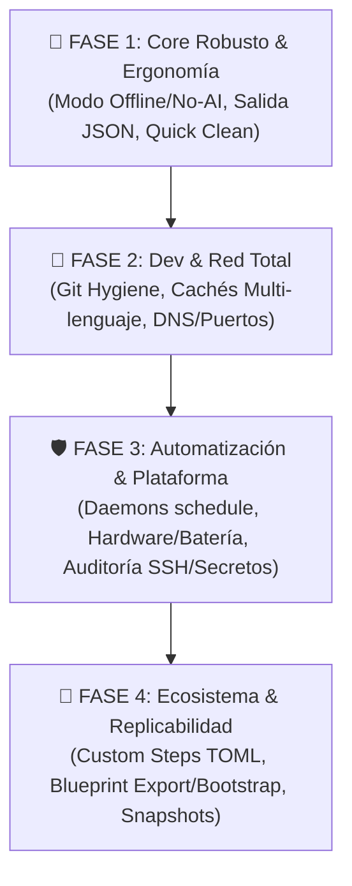

# 📋 TODO: Omega — La Herramienta de Mantenimiento Total

> **Visión**: Convertir a **Omega** en el estándar definitivo de mantenimiento de sistemas para **macOS, Linux y Windows**. Una herramienta única que une la simplicidad y seguridad para **usuarios cotidianos** con la potencia, diagnóstico profundo, scriptabilidad y personalización extrema que exigen **desarrolladores, sysadmins y usuarios avanzados**.

---

## 📑 Índice de Contenidos

1. [Arquitectura del CLI, Ergonomía y Modos de Ejecución](#1-arquitectura-del-cli-ergonomía-y-modos-de-ejecución)
2. [Experiencia para Usuarios Normales (Simplicidad y Confianza)](#2-experiencia-para-usuarios-normales-simplicidad-y-confianza)
3. [Mantenimiento Avanzado para Desarrolladores y Power Users](#3-mantenimiento-avanzado-para-desarrolladores-y-power-users)
4. [Red, DNS y Diagnóstico de Conectividad](#4-red-dns-y-diagnóstico-de-conectividad)
5. [Salud de Hardware, Batería, Almacenamiento y Rendimiento](#5-salud-de-hardware-batería-almacenamiento-y-rendimiento)
6. [Seguridad, Privacidad e Higiene de Secretos](#6-seguridad-privacidad-e-higiene-de-secretos)
7. [Extensibilidad: Pasos Personalizados, Plugins y Hooks](#7-extensibilidad-pasos-personalizados-plugins-y-hooks)
8. [Exportación, Clonado de Entornos y Backups (Replicabilidad)](#8-exportación-clonado-de-entornos-y-backups-replicabilidad)
9. [Mejoras del Agente IA y Control de Presupuesto](#9-mejoras-del-agente-ia-y-control-de-presupuesto)
10. [Roadmap y Prioridades de Implementación](#10-roadmap-y-prioridades-de-implementación)

---

## 1. Arquitectura del CLI, Ergonomía y Modos de Ejecución

### 1.1. Modo Determinista y Offline (`--no-ai` / `--offline`)
- [x] **Mantenimiento sin dependencia de LLM**:
  - Actualmente, `omega`, `omega update`, `omega clean` y `omega analyze` requieren un proveedor de IA configurado o un servidor local como Ollama.
  - Implementar un modo `--no-ai` (o detección automática de falta de credenciales/conexión) que ejecute el catálogo completo de pasos de forma determinista y segura, con TUI enriquecida, sin realizar llamadas a APIs externas.
  - La IA debe actuar como un **amplificador y diagnosticador inteligente** (para resolución de fallos, `omega fix`, sugerencias contextuales), no como un bloqueo obligatorio para actualizar paquetes o limpiar temporales.

### 1.2. Salidas Estructuradas para Scripts y CI/CD (`--format` / `--json`)
- [x] **Soporte de salida JSON / YAML**:
  - Añadir `--json` o `--format=json|yaml|table|markdown|csv` a todos los comandos de diagnóstico e inventario:
    - `omega analyze --json`: métricas de disco, actualizaciones pendientes, problemas encontrados.
    - `omega health --json`: salud de disco (SMART), batería, memoria, estado de firewall y copias de seguridad.
    - `omega dev status --json`: inventario detallado de lenguajes, gestores de versiones y conflictos.
    - `omega doctor --json`: resultado de preflight checks.
    - `omega steps --json`: listado completo de pasos disponibles y su soporte en el host actual.
- [x] **Códigos de salida semánticos**:
  - Estandarizar códigos de salida para pipelines de CI/CD:
    - `0`: Ejecución completada sin problemas / Sistema saludable.
    - `1`: Error de ejecución o fallo de proveedor.
    - `2`: Advertencias detectadas o acciones pendientes recomendadas (en `analyze` y `doctor`).
    - `130`: Interrupción de usuario (Ctrl+C).
  - Añadir flags de aserción en CI: `--fail-on-warning`, `--fail-on-outdated`, `--fail-on-critical`.

### 1.3. Control de Salida y Niveles de Log
- [x] **Flags estándar de verbosidad**:
  - `-q, --quiet`: modo silencioso (solo errores fatales), ideal para cron o hooks desatendidos.
  - `-v, --verbose`: muestra comandos exactos en tiempo real, variables de entorno pasadas y tiempos de ejecución.
  - `--debug`: volcado detallado de peticiones/respuestas a la API del LLM, tiempos de red, tokens consumidos y llamadas al runner.

### 1.4. Shell Interactivo / Consola REPL (`omega shell`)
- [x] **Modo consola interactiva**:
  - Un entorno interactivo con autocompletado avanzado para ejecutar diagnósticos sucesivos, consultar notas, inspeccionar salidas de herramientas y aplicar correcciones sin reiniciar el proceso CLI.

### 1.5. Autocompletado y Manuales
- [x] **Instalador automático de autocompletado (`omega completion install`)**:
  - Detectar la shell en uso (`zsh`, `bash`, `fish`, `powershell`) e instalar el script de autocompletado en el directorio correspondiente (`~/.zsh/completion`, `~/.config/fish/completions/omega.fish`, etc.).
- [x] **Generación de man pages (`omega man`)**:
  - Generar páginas de manual de troff (`omega.1`) para integración en sistemas UNIX.

---

## 2. Experiencia para Usuarios Normales (Simplicidad y Confianza)

### 2.1. Modo "Un Clic" de Mantenimiento Seguro (`omega quick` / `omega easy`)
- [x] **Flujo para usuarios no técnicos**:
  - Tarea ultra-segura, cero configuración y sin preguntas complejas:
    - Vacía la Papelera / Recycle Bin.
    - Limpia cachés de usuario seguras (temporales de descargas, miniaturas).
    - Comprueba actualizaciones de aplicaciones de usuario (Homebrew Casks, Mac App Store, Winget, Flatpak).
    - Revisa salud de la batería y espacio libre en disco.
    - Emite un informe visual sencillo: *"Tu equipo está al 100%. Se han liberado 4.2 GB y actualizado 3 apps"*.

### 2.2. Explicaciones en Lenguaje Claro ("Explain Like I'm Five")
- [x] **Traducción de comandos crudos a lenguaje natural**:
  - En lugar de mostrar comandos técnicos como `rm -rf ~/Library/Developer/Xcode/DerivedData/*`, mostrar en la interfaz tarjetas explicativas accesibles:
    - *¿Qué es?*: "Archivos temporales generados al compilar en Xcode."
    - *¿Es seguro?*: "Completamente seguro: Xcode los vuelve a generar si los necesita."
    - *Espacio estimado recuperable*: "+12.4 GB".
  - Nivel de detalle configurable (`omega config set explain_level simple|technical`).

### 2.3. Programador de Tareas Desatendidas y Notificaciones (`omega schedule`)
- [x] **Gestión nativa de automatización**:
  - Crear e instalar automáticamente tareas programadas en el sistema nativo:
    - **macOS**: `launchd` LaunchAgent (`~/Library/LaunchAgents/com.omega.maintenance.plist`).
    - **Linux**: `systemd --user` timer & service (`~/.config/systemd/user/omega-maintenance.timer`).
    - **Windows**: Programador de Tareas de Windows (`schtasks`).
  - Subcomandos:
    - `omega schedule install [--interval daily|weekly|monthly] [--task quick|full|update|clean] [--at 03:00]`
    - `omega schedule status`: ver última ejecución programada, próxima ejecución y logs.
    - `omega schedule uninstall`: desinstala el daemon/timer de forma limpia.
- [x] **Notificaciones nativas de escritorio**:
  - Notificaciones en macOS (Notification Center vía osascript), Linux (`notify-send` / D-Bus) y Windows (PowerShell Toast Notifications) tras completar mantenimiento programado o si el disco baja del 10% de espacio libre.

### 2.4. Desinstalador Profundo de Aplicaciones (`omega uninstall <app>`)
- [x] **Eliminación limpia y completa de software** (estilo AppCleaner en Mac / Geek Uninstaller en Windows):
  - Localizar y listar para confirmación todos los archivos residuales al desinstalar un programa:
    - Binario/Bundle de la aplicación (`/Applications`, `C:\Program Files`, `/usr/bin`).
    - Preferencias (`~/Library/Preferences`, registros de Windows).
    - Application Support y datos locales (`~/Library/Application Support`, `%LOCALAPPDATA%`, `~/.local/share`).
    - Cachés (`~/Library/Caches`, `%TEMP%`, `~/.cache`).
    - LaunchAgents / Servicios asociados.
  - Capacidad de mover todo a la papelera antes del borrado definitivo con posibilidad de deshacer.

### 2.5. Buscador Visual de Archivos Duplicados y Ficheros Gigantes
- [x] **Búsqueda de archivos duplicados (`omega disk duplicates`)**:
  - Identificar duplicados en carpetas clave (`~/Downloads`, `~/Documents`, etc.) comparando tamaño y hash criptográfico seguro (SHA-256).
  - Interfaz de selección interactiva para conservar la copia más antigua/reciente y mover el resto a la papelera.
- [x] **Navegador visual de espacio en terminal (`omega disk map` / `omega disk tree`)**:
  - Visualización interactiva en terminal (estilo `ncdu` / `gdu` pero nativa con Lipgloss/Bubbletea) para explorar visualmente carpetas que consumen gigabytes.

---

## 3. Mantenimiento Avanzado para Desarrolladores y Power Users

### 3.1. Higiene Profunda de Repositorios Git (`omega git` / `omega dev git`)
- [x] **Auditoría masiva de repositorios en directorios de desarrollo**:
  - Escanear carpetas habituales (`~/Dev`, `~/Projects`, `~/Code`, `~/work`, etc.):
    - **Ramas huérfanas**: detectar ramas locales ya fusionadas en `main`/`master` (`git branch --merged`) y ofrecer eliminarlas.
    - **Trabajo no guardado / no enviado**: alertar de repositorios con cambios sin commitear o commits locales sin push con más de 7 días de antigüedad.
    - **Optimización de `.git`**: ejecutar `git gc --prune=now` y empaquetado en repositorios pesados para recuperar cientos de megabytes.
    - **Archivos sobredimensionados**: avisar de archivos de más de 50MB que estén en el historial de Git sin Git LFS.
    - **Detección de secretos filtrados**: escanear ficheros `.env`, claves privadas `id_rsa`, o tokens de API comiteados accidentalmente.

### 3.2. Limpieza Inteligente de Artefactos de Construcción por Ecosistema
- [x] **Ecosistema Node.js / JavaScript / TypeScript**:
  - Detección global de carpetas `node_modules` en proyectos inactivos (>30 días) con cálculo de espacio total (a menudo decenas de GB).
  - Comando interactivo: `omega clean dev-artifacts --older-than 30d`.
  - Limpieza de cachés de npm (`npm cache clean --force`), pnpm store prune, yarn cache clean, bun cache.
  - Detección de versiones obsoletas de Node instaladas en `nvm`, `fnm`, `volta` o `mise`.
- [x] **Ecosistema Python**:
  - Limpieza de entornos virtuales abandonados (`.venv`, `env`, virtualenvs de poetry, pipenv o uv).
  - Limpieza profunda de cachés: `.pytest_cache`, `.ruff_cache`, `.mypy_cache`, carpetas `__pycache__` y ficheros `*.pyc` en desuso.
  - Poda de versiones antiguas de Python no usadas en `pyenv`.
- [x] **Ecosistema Rust**:
  - Limpieza de carpetas `target/` en proyectos inactivos (utilizando lógica estilo `cargo-sweep`).
  - Limpieza de crates de fuentes extraídas y metadatos con `cargo-cache`.
  - Poda de toolchains antiguos de Rust (`rustup toolchain list`).
- [x] **Ecosistema Go**:
  - Limpieza de caché de compilación (`go clean -cache`) y caché de pruebas (`go clean -testcache`).
  - Eliminación de toolchains automáticos descargados en desuso (`~/.go/toolchains` o `~/sdk`).
  - Poda de la caché de módulos (`go clean -modcache`).
- [x] **Ecosistemas Java, Kotlin y C/C++**:
  - Detención de daemons colgados de Gradle (`gradle --stop`) y purga de cachés descargadas de Gradle y Maven (`.lastUpdated`).
  - Limpieza de cachés de compilación de CMake, `vcpkg` y `conan`.

### 3.3. Limpieza de Entornos de Contenedores y Cloud (`omega docker`, `omega podman`, `omega k8s`)
- [x] **Ampliación de mantenimiento de contenedores**:
  - **Docker**:
    - Truncado y vaciado de logs de contenedores (`/var/lib/docker/containers/*/*-json.log`) que crecen silenciosamente hasta llenar el disco.
    - Compactación del disco virtual de Docker Desktop / OrbStack / Colima (reclamación de almacenamiento sparse en macOS y Windows).
  - **Podman**:
    - Soporte completo para Podman: `podman system df`, `podman system prune`, eliminación de contenedores y pods huérfanos.
  - **Kubernetes**:
    - Limpieza de caché del cliente `kubectl` (`~/.kube/cache`, `~/.kube/http-cache`).
    - Detección de contextos expirados o clústeres inalcanzables en `~/.kube/config`.
  - **Herramientas Cloud**:
    - Limpieza de caché de AWS CLI (`~/.aws/cli/cache`).
    - Limpieza de backups de componentes de Google Cloud SDK (`gcloud components`).
    - Limpieza de cachés de Azure CLI (`~/.azure/cache`).

### 3.4. Higiene de IDEs y Editores de Código
- [x] **VS Code / Cursor / Windsurf**:
  - Limpieza de `workspaceStorage` de proyectos borrados o renombrados.
  - Limpieza de extensiones antiguas desinstaladas y volcados de fallos (crash dumps).
  - Limpieza de cachés de Language Servers (gopls, rust-analyzer, pyright, tsserver) que acumulan gigabytes.
- [x] **JetBrains IDEs (IntelliJ, PyCharm, GoLand, WebStorm)**:
  - Detección y limpieza de carpetas de versiones antiguas del IDE en `~/Library/Caches/JetBrains` o `~/.cache/JetBrains`.
  - Vaciado de índices corruptos o desactualizados.
- [x] **Xcode (macOS)**:
  - Añadir soporte para:
    - Borrado de archivos de distribución y archivo antiguos (`~/Library/Developer/Xcode/Archives`).
    - Simuladores y runtimes de iOS/watchOS/tvOS huérfanos o desactualizados.
    - Documentación de versiones anteriores.

### 3.5. Diagnóstico de Variables de Entorno y Perfilado de Shell
- [x] **Auditoría y saneamiento de `$PATH` (`omega env path`)**:
  - Detectar directorios inexistentes o muertos en `$PATH`.
  - Detectar rutas duplicadas o desordenadas.
  - Advertir sobre rutas inseguras (como `.` o directorios temporales con permisos de escritura para cualquiera).
- [x] **Perfilado del tiempo de arranque de la Shell (`omega dev profile-shell`)**:
  - Medir línea a línea o bloque a bloque el coste de arranque de `.zshrc` / `.bashrc` / `config.fish` (mediante `zsh/zprof` o timers de ejecución).
  - Identificar qué plugin, inicialización de gestor de versiones (`nvm`, `pyenv`, `mise`) o binario externo causa lentitud en la terminal.
- [x] **Auditoría de conflictos de variables de entorno**:
  - Detectar incoherencias entre `JAVA_HOME`, `GOROOT`/`GOPATH`, `PYTHONPATH`, o flags de Node como `NODE_OPTIONS`.

---

## 4. Red, DNS y Diagnóstico de Conectividad

### 4.1. Vaciado de Caché DNS y Pila de Red (`omega net flush`)
- [x] **Comando unificado de vaciado de DNS**:
  - **macOS**: `dscacheutil -flushcache; sudo killall -HUP mDNSResponder`.
  - **Linux**: `resolvectl flush-caches` o `systemd-resolve --flush-caches` (según versión de systemd).
  - **Windows**: `Clear-DnsClientCache` o `ipconfig /flushdns`.
  - Muy demandado por desarrolladores tras cambios en dominios locales o registros DNS.

### 4.2. Comprobador de Latencia y Disponibilidad de Registros (`omega net ping`)
- [x] **Test rápido de mirrors y registros de paquetes**:
  - Comprobar latencia y accesibilidad contra los registros principales:
    - Homebrew GitHub mirrors, npmjs.org, PyPI, crates.io, Docker Hub, Ubuntu/Debian mirrors, Arch Linux mirrors.
  - Identificar de inmediato si un fallo en `omega update` se debe a un corte de red, un proxy caído o un bloqueo de ISP.

### 4.3. Cazador de Conflictos de Puertos (`omega net ports` / `omega net kill <puerto>`)
- [x] **Diagnóstico de puertos locales ocupados**:
  - Listar qué proceso tiene ocupado un puerto concreto (ej. 3000, 5000, 8080, 5432, 6379, 27017).
  - Ofrecer finalizar de forma interactiva y segura procesos zombie o servidores olvidados (`lsof -i :<port>` en Unix, `Get-NetTCPConnection` en Windows).

### 4.4. Auditoría de Ficheros Hosts y Proxies Fantasma (`omega net audit`)
- [x] **Revisión de `/etc/hosts` / `hosts` de Windows**:
  - Comprobar si existen redirecciones obsoletas de antiguos proyectos de Docker, Kubernetes local (Minikube), Vagrant o bloqueadores de publicidad.
- [x] **Detección de variables de proxy persistentes**:
  - Advertir sobre variables `HTTP_PROXY`, `HTTPS_PROXY` o `ALL_PROXY` configuradas en el entorno que apunten a endpoints caídos y rompan herramientas CLI como curl o git.

---

## 5. Salud de Hardware, Batería, Almacenamiento y Rendimiento

### 5.1. Cuidado y Salud de la Batería
- [x] **Métricas avanzadas de batería (`omega health battery`)**:
  - **macOS**: Porcentaje de degradación, recuento de ciclos, estado de condición de la batería, historial térmico y comprobación de consumo excesivo de energía por apps en segundo plano (`powermetrics` / `pmset -g batt`).
  - **Linux**: Integración con `upower` o `/sys/class/power_supply/`, porcentaje de desgaste frente a capacidad de diseño, consumo actual en vatios y estado de servicios de ahorro de energía (TLP / auto-cpufreq).
  - **Windows**: Generación e interpretación automática de `powercfg /batteryreport` con análisis de salud y recomendaciones.

### 5.2. Diagnósticos de Disco NVMe / SSD y Almacenamiento
- [x] **Monitoreo de desgaste SMART y TBW (Total Bytes Written)**:
  - Integrar diagnósticos SMART avanzados (mediante `smartctl` / smartmontools o llamadas nativas) para calcular la vida útil restante de discos NVMe y SSD.
  - Alerta temprana de sectores reasignados o fallos inminentes de hardware para prevenir pérdida de datos.
- [x] **Gestión de instantáneas locales (Snapshots)**:
  - **macOS**: Poda de instantáneas locales de Time Machine (`tmutil thinlocalsnapshots / <bytes>`) que a menudo retienen decenas de GB invisibles en el Finder.
  - **Linux**: Inspección de instantáneas de Btrfs (`snapper`) o ZFS.
  - **Windows**: Limpieza de copias de instantáneas de volumen (VSS Shadow Copies) antiguas.

### 5.3. Monitor de Procesos Rebeldes y Liberación de Memoria RAM
- [x] **Cazador de procesos desbocados (`omega health top`)**:
  - Identificar procesos que lleven más de 15 minutos consumiendo >90% de CPU o que sufran fugas de memoria evidentes.
  - Identificar daemons en bucle de fallo (`launchd` o `systemd` que reinician cada segundo consumiendo ciclos).
- [x] **Liberación de memoria en caché (`omega health purge-ram`)**:
  - **macOS**: `sudo purge` para liberar memoria inactiva y cachés del kernel.
  - **Linux**: `sync; echo 3 > /proc/sys/vm/drop_caches` para liberar dentries, inodes y pagecache.
  - **Windows**: Integración con llamada a liberación de working sets.

---

## 6. Seguridad, Privacidad e Higiene de Secretos

### 6.1. Auditoría de Claves SSH y Permisos Criptográficos (`omega audit ssh`)
- [x] **Revisión de `~/.ssh`**:
  - Comprobación estricta de permisos de archivos:
    - Directorio `~/.ssh` debe ser `0700`.
    - Claves privadas (`id_ed25519`, `id_rsa`) deben ser `0600` (alertar si tienen `0644`).
    - Claves públicas y `known_hosts` deben ser `0644`.
  - Verificación sintáctica de `~/.ssh/config` (directivas huérfanas o rutas a claves inexistentes).
  - Detección de claves públicas obsoletas o débiles (RSA < 2048 bits).
  - Limpieza de entradas duplicadas o caducadas en `known_hosts`.

### 6.2. Escaneo de Fugas de Secretos en Entornos Locales (`omega audit secrets`)
- [x] **Detector de credenciales expuestas en la máquina**:
  - Escanear el historial de la shell (`.zsh_history`, `.bash_history`, historial de PowerShell) en busca de tokens pegados por descuido (OpenAI API keys, Anthropic keys, GitHub PATs, AWS Access Keys, contraseñas en comandos `curl`).
  - Ofrecer redactar o sanitizar esas líneas en el fichero de historial correspondiente.

### 6.3. Privacidad y Telemetría del Sistema Operativo (`omega privacy`)
- [x] **Revisión de telemetría y diagnósticos**:
  - Ofrecer deshabilitar de forma transparente telemetría intrusiva o envío constante de informes de diagnóstico:
    - **macOS**: Desactivar envío de reportes de diagnóstico a Apple y CrashReporter innecesario en máquinas de desarrollo.
    - **Windows**: Comprobar estado de Diagnostic Data y deshabilitar tareas de recopilación de telemetría de Windows CEIP.
    - **Linux**: Revisar estado de `popularity-contest` (Debian/Ubuntu), `ubuntu-report`, o servicios de telemetría de distribución.
- [x] **Limpieza opcional de cachés de navegadores**:
  - Soporte de limpieza de cachés web pesadas para los principales navegadores (Safari, Chrome, Firefox, Brave, Arc, Edge) respetando cookies y sesiones para no desloguear al usuario.

---

## 7. Extensibilidad: Pasos Personalizados, Plugins y Hooks

### 7.1. Definición de Pasos Propios vía Configuración (`steps.d/`)
- [x] **Pasos declarativos en TOML/YAML sin recompilar**:
  - Permitir a usuarios, empresas o equipos definir sus propios pasos de mantenimiento en `~/.config/omega/steps.d/*.toml` o en la sección `[[custom_steps]]` de `config.toml`.
  - Formato declarativo:
    ```toml
    [[steps]]
    id = "internal-vpn-cache"
    name = "Limpiar caché de VPN corporativa"
    category = "clean"
    command = "my-vpn-cli cache clear"
    risk = "normal"
    requires = "my-vpn-cli"
    os = "darwin"
    ```
  - Estos pasos personalizados se integran automáticamente en `omega steps`, `omega clean`, `omega menu` y en el agente IA.

### 7.2. Hooks Pre y Post Ejecución
- [x] **Disparadores de eventos en el ciclo de vida**:
  - Configurar scripts que se ejecuten automáticamente antes o después de ciertas tareas:
    - `hooks.pre_full`: ej. comprobar estado de red o hacer snapshot del sistema.
    - `hooks.post_full`: ej. enviar una notificación a Slack/Discord o registrar métricas en un log centralizado.
    - `hooks.on_error`: ej. alertar al administrador o volcar un informe de diagnóstico.

### 7.3. Instantáneas Preventivas de Sistema (Rollback Safety)
- [x] **Snapshots automáticos antes de actualizaciones mayores**:
  - Antes de ejecutar `omega update` o un mantenimiento peligroso:
    - **macOS (APFS)**: Crear automáticamente un APFS local snapshot con `tmutil snapshot`.
    - **Linux (Btrfs/ZFS)**: Crear un snapshot con `snapper` o `zfs snapshot`.
    - **Windows**: Crear un punto de restauración del sistema con `Checkpoint-Computer`.
  - Si una actualización del sistema o de paquetes rompe el entorno, permitir la reversión al estado previo con un solo comando: `omega rollback`.

---

## 8. Exportación, Clonado de Entornos y Backups (Replicabilidad)

### 8.1. Exportación del Blueprint del Sistema (`omega export` / `omega backup`)
- [x] **Exportación unificada del estado del sistema**:
  - Generar un archivo portátil `omega-blueprint.json` (o `.tar.gz`) que contenga:
    - Lista de paquetes de todos los gestores instalados (Brewfile, winget export, flatpak list, pacman/apt list, pipx, npm global).
    - Lista de herramientas de desarrollo detectadas por `omega dev`.
    - Configuración de Omega (`config.toml`) y notas acumuladas (`notes.md`).
    - Metadatos de versión del sistema operativo.

### 8.2. Aprovisionamiento y Restauración de Máquinas (`omega bootstrap`)
- [x] **Replicación en un nuevo equipo**:
  - En un ordenador nuevo recién instalado: `omega bootstrap omega-blueprint.json`.
  - El instalador:
    1. Instala los gestores de paquetes faltantes.
    2. Instala en lote las herramientas y paquetes guardados.
    3. Restaura la configuración y shell lines necesarias (`omega dev activate`).
  - Transforma a Omega en la herramienta definitiva de *dotfiles*, backup y aprovisionamiento de puestos de trabajo.

---

## 9. Mejoras del Agente IA y Control de Presupuesto

### 9.1. Guardarraíles de Coste y Presupuesto de Tokens
- [x] **Límites de gasto por sesión y mensuales**:
  - Opciones de línea de comandos:
    - `--max-cost 0.10`: abortar o no escalar a modelos caros si el coste estimado supera los 10 céntimos de dólar.
    - `--max-turns 15`: limitar el número máximo de turnos del agente para evitar bucles infinitos en diagnósticos complejos.
  - Almacenar el coste acumulado en el estado local y permitir consultar el gasto histórico: `omega models usage`.

### 9.2. Análisis Directo de Logs y Traza de Fallos (`omega fix --log`)
- [x] **Diagnóstico de errores externos asistido por IA**:
  - Permitir al usuario pasar logs de compilaciones fallidas, errores de brew o fallos del sistema directamente:
    - `omega fix --log /var/log/system.log`
    - `omega fix "error TS2307: Cannot find module '@core/utils'"`
    - `cat build.log | omega fix -`
  - El agente analiza la traza, localiza la causa raíz (dependencia faltante, variable mal configurada, puerto ocupado) y propone la solución interactiva en una tarjeta.

---

## 10. Roadmap y Prioridades de Implementación

Para asegurar un desarrollo iterativo y enfocado, las funcionalidades se estructuran en cuatro fases de entrega:



### 🎯 Fase 1: Core Robusto, Scriptabilidad y Facilidad de Uso
*Objetivo: Romper la dependencia obligatoria de la IA para tareas rutinarias y habilitar la automatización en scripts y perfiles no técnicos.*
1. **Modo `--no-ai` / `--offline`**: motor determinista que corre el catálogo de pasos sin exigir clave de API.
2. **Salida `--json` / `--format`**: soporte estructurado en `analyze`, `health`, `dev status`, `doctor`.
3. **`omega quick`**: comando ultra-seguro y simplificado de un clic para usuarios cotidianos.
4. **Niveles de log y códigos de salida estándar** (`--quiet`, `--verbose`, códigos de salida semánticos).
5. **Autocompletado automático** (`omega completion install`).

### 🚀 Fase 2: Profundidad para Desarrolladores y Red
*Objetivo: Atacar los mayores dolores de cabeza diarios de programadores e ingenieros de software.*
1. **`omega dev git`**: detección de ramas fusionadas huérfanas, repos sucios y optimización de `.git`.
2. **Limpieza profunda de cachés de desarrollo**: `node_modules` antiguos, `target/` de Rust, `.venv` huérfanos, cachés de compilación de Go.
3. **Mantenimiento de Contenedores e IDEs**: vaciado de logs de Docker, soporte Podman, almacenamiento de VS Code y JetBrains.
4. **Herramientas de Red (`omega net`)**: vaciado universal de DNS (`flush`), comprobador de registros (`ping`) y liberador de puertos ocupados (`ports`).

### 🛡️ Fase 3: Automatización en Segundo Plano, Hardware y Seguridad
*Objetivo: Convertir a Omega en un guardián silencioso, proactivo y protector de la máquina.*
1. **Planificador de tareas (`omega schedule`)**: integración con `launchd`, `systemd` y Windows Task Scheduler con notificaciones nativas de escritorio.
2. **Salud de Hardware y Batería**: métricas profundas de ciclos, desgaste de batería, salud SMART de NVMe y cazador de procesos desbocados.
3. **Auditoría de Seguridad y Privacidad**: permisos de `~/.ssh`, escáner de claves expuestas en historial de shell y revisión de telemetría.
4. **Desinstalador limpio de aplicaciones (`omega uninstall`)**: borrado integral de rastros de apps con recuperación en papelera.

### 👑 Fase 4: Ecosistema, Extensibilidad y Replicabilidad
*Objetivo: Permitir personalización absoluta para equipos y portabilidad total de entornos de desarrollo.*
1. **Pasos personalizados (`steps.d/*.toml`)**: soporte para pasos de mantenimiento definidos por el usuario o empresa.
2. **Hooks de ciclo de vida**: ejecución de scripts pre y post mantenimiento con alertas webhooks.
3. **Puntos de restauración / Snapshots automáticos**: integración con APFS, Btrfs y puntos de restauración antes de actualizar el sistema.
4. **`omega export` y `omega bootstrap`**: exportación e importación completa del estado de paquetes y configuración para configurar ordenadores nuevos en minutos.
5. **Guardarraíles de coste y análisis de logs**: límites de gasto y diagnóstico directo de ficheros de error externos.
