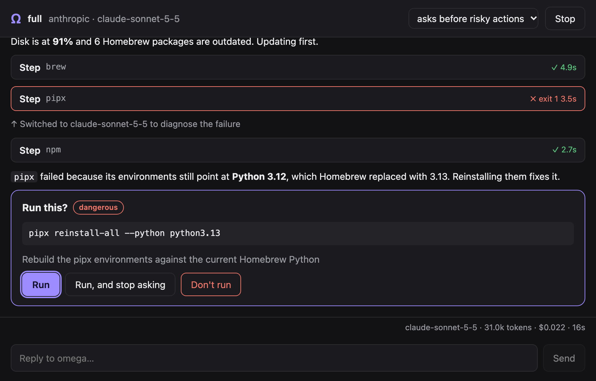

# How it works, development and releasing

[omega](../../README.md) › [Manual](README.md) › How it works, development and releasing

- [How it works](#how-it-works)
- [Development](#development)
- [Releasing](#releasing)

## How it works

```text
            ┌──────────────┐   events   ┌──────────────────────┐
  task ───▶ │    agent     │ ─────────▶ │  TUI / plain output  │ ──▶ you
            │ (loop + AI)  │ ◀───────── │ (approvals, cards)   │
            └──────┬───────┘  decisions └──────────────────────┘
                   │ tools
   ┌───────────────┼───────────────────────────────────────────────┐
   │ system_info  list_steps  run_step  run_command  disk_usage   │
   │ read_file  write_file  remember  propose_actions             │
   │ config_hints  web_search  fetch_url                          │
   │ mac_inventory  mac_change  mac_policy                        │
   └───────────────┬───────────────────────────────────────────────┘
                   │ risk classifier (safety)
                   ▼
           runner: zsh -lc, stdin closed, timeout, live output
```

1. omega sends the model a system prompt (role, workflow, rules, disabled steps
   and notes from previous runs) and the task.
2. The model answers with text and/or tool calls.
3. Each call goes through the approval policy: it runs, you are asked, or it is
   rejected. Read-only calls from the same answer run together; a change, or a
   question, keeps the batch in order. Results go back to the model trimmed to
   the first 2 KB and the last 8 KB, including when a single line is huge.
4. When a catalogue step fails and the model is on the fast tier, omega switches
   to the smart tier for the rest of the session.
5. The loop continues until the model stops asking for tools. In interactive
   mode you can keep the conversation going.

Code layout:

```text
cmd/omega/          entry point
cmd/omega-gui/      desktop app (Wails, build tag gui) and its frontend
internal/cli/       commands (setup, model, docker, mac, auth, config, steps, notes, logs, doctor), key checks
internal/agent/     agent loop, tools, config hints, web tools, prompt, events, run log
internal/llm/       providers (Anthropic SDK, OpenAI-compatible, OpenCode), tiers, prices
internal/safety/    command risk classifier
internal/runner/    command execution in its own session with live output
internal/sudo/      sudo bridge: wrapper, askpass helper and password checks
internal/steps/     step catalogue
internal/macos/     login and background items, menu bar, Dock, keyboard shortcuts, defaults, undo journal
internal/ui/        TUI (Bubble Tea, glamour), selection cards, plain output
internal/gui/       bridge between the agent's events and the desktop app's window
internal/i18n/      translations (en, es, fr, de, pt)
internal/demo/      scripted session for screenshots
internal/config/    configuration and paths
internal/secrets/   API keys: macOS Keychain, Windows Credential Manager, Linux Secret Service or a 0600 file
docs/               website (GitHub Pages) and README assets
docs/manual/        this manual
Formula/omega.rb    template of the Homebrew formula (not an install path)
Casks/omega-app.rb  the desktop app's cask, copied to the tap by a release
```

## Development

```bash
make build     # builds ./bin/omega
make test      # risk classifier, agent loop, model plan, cards, translations, omega mac
make lint      # gofmt + go vet
make cross     # linux, macOS and windows binaries under ./bin
./bin/omega --demo                 # scripted session, no API calls, no real commands
scripts/capture.sh                 # re-record README and Pages captures from that binary
```

### Desktop app (preview)

`cmd/omega-gui` is the same agent in a window, for macOS, Linux and Windows:
a home screen with the tasks, the session with its steps and live output,
cards for approvals, selections and the sudo password, and a setup screen for
the provider and its key. It is built with
[Wails](https://wails.io) on the system webview and shares the agent, the
safety policy, the configuration and the translations with the command.
The model is chosen automatically: `omega model` is still the way to fix one.

Since 0.17.0 a release publishes
`omega-macos-universal.dmg` (`Omega.app`, Apple Silicon and Intel),
`omega-gui_<version>_linux_{amd64,arm64}.tar.gz` and
`omega-gui_<version>_windows_{amd64,arm64}.zip`, and on macOS it installs with
`brew install --cask lcajigasm/tap/omega-app`. The app is ad-hoc signed and
not notarized, so macOS quarantines it: run
`xattr -dr com.apple.quarantine /Applications/Omega.app` after installing.
The Windows build is not signed either, and SmartScreen warns on first run.
The command stays its own formula; the two share configuration and keys.



*Recorded from the app by `scripts/capture_gui.mjs`, in its demo mode.*

```bash
make gui                           # builds ./bin/omega-gui (cgo on macOS and Linux)
make gui-app                       # macOS: wraps it in ./bin/Omega.app, ad-hoc signed
make gui-dmg                       # macOS: universal app in ./bin/omega-macos-universal.dmg
./bin/omega-gui --demo             # scripted session, no API calls, no real commands
node scripts/capture_gui.mjs       # re-record the app's captures (docs/assets/gui-*.png)
```

On Linux it needs `libgtk-4-dev` and `libwebkitgtk-6.0-dev` to build and GTK 4
with WebKitGTK 6.0 to run. The agent's events reach the window through
`internal/gui`, which has no toolkit in it and is tested like the rest.

Terminal captures in the README are produced only by `scripts/capture.sh`
(see [CONTRIBUTING.md](../../CONTRIBUTING.md)).

To teach `omega mac` about an app, add its bundle id to a category in
`internal/macos/policy.go`, or its default global shortcut to `knownAppHotkeys` in
`internal/macos/hotkeys.go`. To add a step, edit `internal/steps/steps.go` (and add a `step.<id>`
translation). To add configuration hints, edit `internal/agent/hints.go`. To add a
provider, implement `llm.Provider` in `internal/llm/` and register it in
`llm.Providers` and `llm.New`.

## Releasing

Pushing a tag `vX.Y.Z` runs the release workflow, which builds the archives and
publishes them on GitHub Releases. CI on main should be green before the tag.

```bash
git tag v0.10.0 && git push origin v0.10.0
```

The release workflow builds the archives, publishes them with `SHA256SUMS`, and
rewrites `Formula/omega.rb` in this repository (version and the sha256 of each
archive) on `main`. That file is a template. It is not an install path:
`brew install` uses [`lcajigasm/homebrew-tap`](https://github.com/lcajigasm/homebrew-tap)
(`brew install lcajigasm/tap/omega`). The workflow does not move the tag.

The same run builds the desktop app: the universal disk image on a macOS
runner (`scripts/package_macos.sh`), the Linux archives on amd64 and arm64
runners and the Windows archives by cross-compiling. `SHA256SUMS` lists them
too, and `Casks/omega-app.rb` here gets this version and the sha256 of the
disk image. The pull request on the tap carries that cask next to the formula.

After the release exists, the job opens a pull request on `lcajigasm/homebrew-tap`
that sets `Formula/omega.rb` to this version and the sha256 of `darwin_arm64`,
`darwin_amd64`, `linux_arm64` and `linux_amd64` from `SHA256SUMS`. It does that
only when the `HOMEBREW_TAP_TOKEN` secret is present. When the secret is absent,
the job prints an error that the tap must be updated by hand and `verify-taps`
fails on the first check instead of waiting.

`verify-taps` reads `Formula/omega.rb` from `lcajigasm/homebrew-tap` on the
public GitHub API (no token) and compares its version with the tag. It tries
again every 5 minutes for up to 75 minutes, and the run fails if the formula
is still on another version. A release created by the workflow token does not
start other workflows, so the release job starts this one. Check a tag by hand
with:

```bash
gh workflow run verify-taps.yml --ref main -f tag=v0.10.0
```
