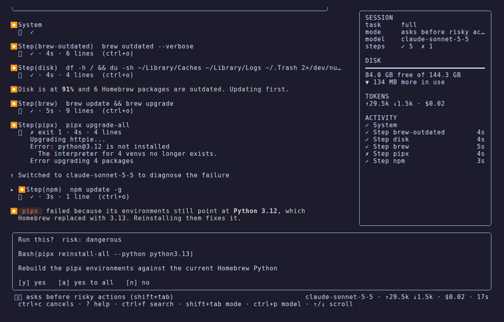
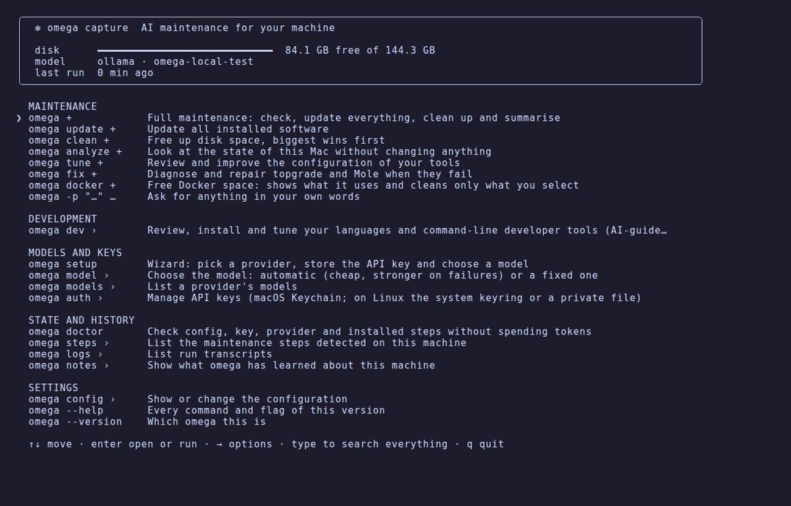
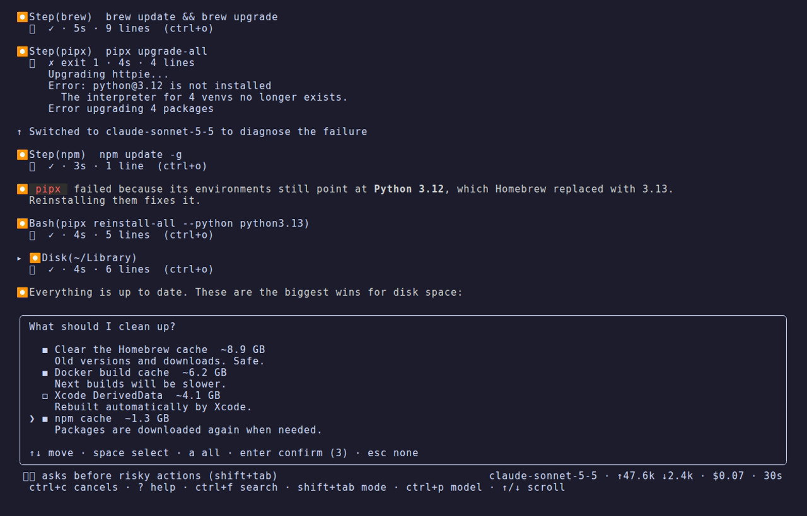

# The interface

[omega](../../README.md) › [Manual](README.md) › The interface

- [The interface](#the-interface)
- [Choosing what to do: selection cards](#choosing-what-to-do-selection-cards)

## The interface

omega's TUI follows the conventions of Claude Code's CLI:

- **Welcome box** with the provider, the model (and which one it escalates to),
  the task, the mode and the path of the run log.
- **Tool calls** as `⏺ Step(brew)`, `⏺ Bash(…)`, `⏺ Disk(~/Library)`,
  `⏺ Fetch(url)`, with a `⎿` result line: status, duration and number of output
  lines. Running calls pulse and stream their last lines; failures show the tail
  of their output and the reason, wrapped to the terminal.
- **Markdown** answers rendered with headings, lists, tables and code.
- **Activity line** with an animated glyph, a shimmering verb, elapsed time and
  tokens so far.
- **Status bar** with the approval mode (change it with `shift+tab`), the current model, tokens in and out,
  cost and elapsed time.
- **Session panel** on the right when the terminal is at least 104 columns
  wide: the task, the mode and the model, how many steps finished, failed or
  were denied, free disk space with what the session freed so far, tokens and
  cost, and every tool call with its outcome and duration. `ctrl+b` (or
  `/panel`) hides it.
- **Cards** for approvals (with a coloured diff when a file changes) and for
  choices. Click a row to select it; click it again, or click the key line, to
  confirm. On an approval card, click `[y]`, `[a]` or `[n]`.

| Key | Action |
|---|---|
| `?` | show or hide the shortcut card (also `/help`) |
| `ctrl+f` | search the transcript. Type the query; Enter or `ctrl+n` jumps to the next match, `ctrl+p` to the previous, Esc closes it. Matches are highlighted |
| `↑` `↓` `PgUp` `PgDn` / wheel | scroll. `PgUp`, `PgDn`, `ctrl+u` and `ctrl+d` also scroll while an approval or a choice card is open |
| `ctrl+o` | expand or collapse the output of every tool call |
| `ctrl+b` | show or hide the session panel |
| `ctrl+y` | copy the focused tool's output to the clipboard |
| `alt+up` / `alt+down` | focus the previous or next tool |
| `shift+tab` | cycle the approval mode: asks before risky actions → auto approve → read only |
| `ctrl+p` (or `alt+p`) | switch to the next model of the run (fast ↔ smart) from the next turn |
| `/` | open the command menu (see below) |
| `y` / `Enter` | approve (`s`, `o`, `j` also work) |
| `a` | approve this and every following request (not available for Docker cleanups) |
| `n` / `Esc` | deny |
| `ctrl+c` | cancel the run |
| `Esc` when the line is empty, or empty `Enter` | end the session (`Esc` first clears a typed line) |

A model you pick by hand is kept: omega no longer switches to the stronger
model on failure. Switching to read only mid-run tells the model, which then
offers changes on a card instead of running them; `a` on an approval card is the
same as switching to auto approve.

When the input box is waiting for you, type `/` for commands. A menu under the
box lists the matching commands with a short explanation and narrows as you
type; `↑` `↓` move, `Tab` completes and `Enter` runs the highlighted one. After
`/mode ` or `/model ` the menu offers the modes or the run's models.

| Command | Action |
|---|---|
| `/help` | list the commands and keyboard shortcuts |
| `/mode [ask\|auto\|readonly]` | change the approval mode (a card when no argument) |
| `/model [name]` | switch model from the next turn (a card when no argument) |
| `/expand` | expand or collapse the output of every tool call |
| `/panel` | show or hide the session panel |
| `/full`, `/update`, `/clean`, `/analyze`, `/health`, `/tune`, `/fix` | start that task in the running session |
| `/mac`, `/permissions`, `/apps` | review what runs on your Mac, its privacy permissions or its apps |
| `/dev`, `/install` | review your development setup, or pick tools to install |
| `/docker` | free up the space Docker uses, only what you pick |
| `/undo` | see what omega changed on this Mac and revert what you pick |
| `/history` | what failed or was left undone in earlier runs |
| `/doctor` | check that omega itself is set up correctly |
| `/disk`, `/logs`, `/shell` | where the disk space goes, what keeps failing in the system logs, why the shell is slow to start |
| `/steps` | the maintenance steps detected on this machine |
| `/login`, `/background`, `/menubar`, `/dock`, `/shortcuts` | one area of the Mac review at a time |
| `/models`, `/settings`, `/notes` | the provider's models with score and price, omega's settings, what omega has noted |

You can also just ask in words. Everything omega does from the command line is
available to the AI in a session:

| You say | The AI uses |
|---|---|
| "install fzf and mise" | `dev_install`, then `dev_activate` for the line in `~/.zshrc` or `~/.bashrc` |
| "undo what you changed in the Dock yesterday" | `mac_history`, `mac_undo` |
| "what failed last time?" | `run_history` (the end of an earlier transcript) |
| "forget the note about pipx" | `notes` |
| "stop running the macOS update step" | `omega_settings` (`skip_steps`) |
| "is omega set up correctly?" | `omega_doctor` |
| "which model should I use?", "why this model?" | `model_ranking` |

Installs, edits to `~/.zshrc`, deleting a note and changing a setting all ask
first, like any other change. Three things stay yours alone, and the AI answers
with the command to run instead: **API keys** (`omega setup`, `omega auth set`),
the **provider** and the **approval policy** (`omega config set approval …`). A
model that could lower its own approval policy or read a key would defeat both.
| `/exit`, `/quit` | end the session and quit |

`omega menu` (or `omega home`) is the home screen: free disk space, the
configured model, when omega last ran, and everything omega can do, to pick
instead of remember. It is built from the command tree, so it lists every
command and subcommand of the version you have.

- **Enter** opens a row marked `›` (a command with subcommands, or a setting
  with its values) and runs any other row. **←** or **Esc** goes back.
- **→** on a row marked `+` shows the other ways to run it: read-only
  (`--dry-run`), automatic (`--auto`), without questions (`--yes`), with the
  sudo password up front, or as plain text.
- A row marked `…` asks for a value first: a request in your own words, a
  model name, the tools to install, a time limit.
- **Typing searches every row at any depth**, also by what it is for: `perm`
  finds `omega mac permissions`, `language` finds the six values of
  `omega config set language`.
- Settings are picked, not typed: `omega config set` lists each key and the
  values it accepts; `omega auth set` lists the providers; `omega steps run`
  lists the steps installed on this machine.

When the command ends, Enter returns to the menu.

With `--no-tui`, or when the output is not a terminal, omega prints plain text
with the same `⏺`/`⎿` structure. Without a terminal on standard input, any action
that needs approval is **denied** unless you pass `--yes`, and cards are skipped.

## Choosing what to do: selection cards

Instead of a wall of recommendations, omega asks with a card:

- **Several actions** (checkboxes): `space` ticks, `a` ticks all, `Enter` runs
  what is ticked, `Esc` runs nothing.
- **One alternative** (radio): `↑` `↓` to move, type to filter, `Enter` to choose.

Each option shows its expected impact (space freed, what it fixes) and is
coloured by risk. omega then carries out exactly the actions you picked, and every
command still goes through the approval rules. In `analyze` and `tune`, the
session stays read only until you pick something.

In plain text mode the card becomes a numbered list: type `1,3`, `all`, or press
Enter for none.
