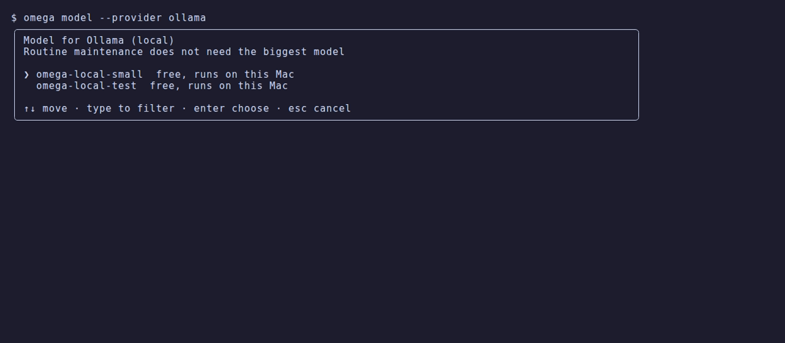

# Models and cost

[omega](../../README.md) › [Manual](README.md) › Models and cost

- [Models and cost](#models-and-cost)
- [Local models](#local-models)

## Models and cost



Routine maintenance does not need the biggest model. With the default
**automatic** choice omega runs on a fast model and switches to a smart one the
first time a step fails, to diagnose it.

Which two models those are is decided from live data, not from a list compiled
into omega. Once a day omega reads OpenRouter's public model catalogue, which
carries each model's list price and its benchmark score (the Artificial
Analysis intelligence index), keeps the models your key can actually use, and
picks:

- **fast**: the best score per dollar among the models that reach at least 40%
  of the best score on offer (score² ÷ price). Price weighs most.
- **smart**: the best value among the models within 20% of the best score
  (score³ ÷ price). Score weighs most, but a model that costs four times more
  for a few points does not win.

Price is the blend a maintenance run pays: three parts input to one part
output. Only models that call tools, answer in text, have a measured score and
are not free, batch or about-to-be-removed routes are eligible. A pick is kept
until another model beats it by more than 10%, so two models that trade places
by a decimal do not alternate.

```bash
omega models                   # every model: score, price, and the two picks
omega models --refresh         # read the catalogue again now
omega models openrouter flash  # another provider, filtered
```

```text
  model                                      score    in $/M   out $/M
  claude-fable-5-2                            64.6        $8       $40
  claude-opus-5-5                             59.1        $4       $20
▸ claude-sonnet-5-5                           54.5        $2       $10  smart
▸ claude-haiku-5-5                            36.5      $0.1      $0.5  fast
```

The download is a plain request to `openrouter.ai` with nothing about you in
it, also when your provider is another one. `omega config set model_catalog off`
stops it. Without a catalogue (first run offline, or switched off) omega uses
the names it was built with: `claude-haiku-5-5` → `claude-sonnet-5-5` for
Anthropic, `gpt-5.4-mini` → `gpt-5.5` for OpenAI, the same Claude pair on
OpenRouter and `claude-sonnet-4-6` on OpenCode Zen. Local providers use the
model you pick.

Limits worth knowing: the score is a general benchmark, not a measure of how
well a model does maintenance; the catalogue has no speed figures; and on
OpenCode Zen the prices used for the comparison are OpenRouter's, which may
differ from what Zen charges.

```bash
omega model                    # card: Automatic, the two tiers, or any model of the provider
omega model claude-sonnet-5-5  # pin a model
omega model auto               # back to automatic
omega --model claude-opus-5-5 fix   # one run with a specific model
```

During a run, `ctrl+p` (or `/model` in the input box) switches between the
run's models from the next turn. A model you pick by hand stays for the rest
of the run, so the automatic switch on failure no longer applies.

Override the tiers per provider with `fast_model` and `smart_model` (see
[Configuration](reference.md#configuration)); they win over the automatic picks. The status
bar and the final summary show the tokens used, including prompt cache reads,
and the cost when the model's price is known; prices come from the same
catalogue, so a model released after your copy of omega is still priced. omega caches the conversation with the Anthropic API, so long sessions
mostly bill cache reads at a tenth of the input price.

As a reference, a read only `omega tune` session on a real Mac (about 190k input
tokens, 80% of them served from the cache, plus six web searches and page reads)
cost **under one cent ($0.009) with Claude Haiku 5.5**, against $2.35 for a
similar session pinned to Claude Opus 5.5 before conversation caching was added.

## Local models

omega can run fully on your Mac with any server that speaks the OpenAI Chat
Completions API:

| Provider | Default endpoint | Notes |
|---|---|---|
| `ollama` | `http://localhost:11434/v1` | `ollama pull qwen3:14b` or another model with tool calling |
| `lmstudio` | `http://localhost:1234/v1` | start the server from LM Studio's Developer tab |
| `custom` | your `base_url` | MLX (`mlx_lm.server`), llama.cpp, vLLM, a corporate gateway… |

```bash
omega setup                   # local servers that are running are marked on the card
omega model --provider ollama # pick one of your local models
omega --provider ollama analyze
```

No API key is needed (one can be stored with `omega auth set custom` for gateways
that require it), local runs show no cost, and omega checks that the server is
reachable before starting. The model must support tool calling; larger models
(14B and up) follow the agent workflow much better than small ones.

**Apple Intelligence.** macOS ships an on-device foundation model, but it is only
reachable from Swift through the FoundationModels framework, and its context
window (4,096 tokens) is too small for an agent that reads command output and
documentation. omega therefore uses local servers such as Ollama, LM Studio or
MLX for on-device runs.
