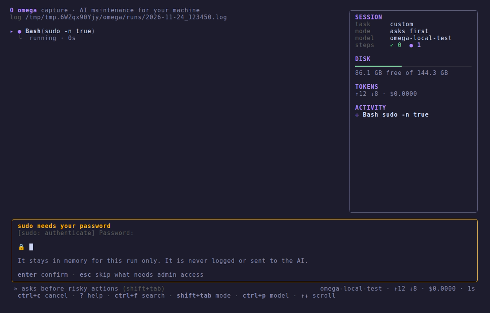

# Safety, approvals and memory

[omega](../../README.md) › [Manual](README.md) › Safety, approvals and memory

- [Safety and approvals](#safety-and-approvals)
- [Memory between runs](#memory-between-runs)

## Safety and approvals

Before running anything, omega classifies the command (including compound
commands with `&&`, `;`, `|`) and applies the highest risk level found:

| Risk | Examples | Default |
|---|---|---|
| **read-only** | `brew outdated`, `df -h`, `git config --list`, `docker system df`, any `--dry-run` or `--help` | runs |
| **normal** | `brew upgrade`, `npm update -g`, `pipx upgrade-all`, `rustup update` | runs |
| **dangerous** | `rm`, `sudo`, output redirection to a file, `sed -i`, `find -delete`, editing configs, **any unknown command** | asks |
| **always ask** | `docker … prune`, `docker rm`, `docker rmi`, `docker volume rm` | asks every time, even with `--yes` |
| **blocked** | `rm -rf ~` or `/` (extra flags and `..` still count), `find / -delete`, `diskutil erase…`, `dd of=/dev/…`, `curl … \| sh`, `csrutil disable`, `nvram`, reading a private key or a credential file (`~/.ssh/id_ed25519`, `~/.aws/credentials`, `~/.netrc`, `.env`, `security … -w`) | never runs |

- `omega config set approval all`: also ask before normal updates.
- `omega config set approval never`, or `--yes`: never ask, except for Docker
  cleanups. Blocked commands stay blocked.
- `--dry-run` (or the `analyze` task): only read-only actions until you pick
  something on a card.
- Commands run with **stdin closed** and non-interactive variables, so nothing
  hangs on a hidden prompt; each command has a time limit (`command_timeout`).

- Commands run in their own session, detached from your terminal, so nothing can
  write over the interface. When something calls `sudo`, a small wrapper sends the
  password request to omega, which shows a **password card**, checks the password
  with sudo and keeps it in memory for that run only (never logged, never sent to
  the AI). `Esc` skips what needs admin access. `omega --sudo` asks for it before
  the run starts instead.
- On a Mac, a command that macOS stops for lack of a privacy permission (Full
  Disk Access, Automation, Accessibility, a protected folder) brings up a card
  that opens the place to grant it and retries when you have; see
  [When macOS blocks omega itself](mac.md#when-macos-blocks-omega-itself).
  omega never grants itself a permission: only you can, in macOS's own window.
- `write_file` always requires approval (unless `--yes`), shows the diff and saves
  a `file.omega-bak-YYYYMMDD-HHMMSS` copy.
- A command that changes what runs later is asked **every time**, also with
  `--yes` and after "approve all", and skipped in an unattended run: one that
  names a shell startup file (`~/.zshrc`, `~/.zshenv`…), `~/.ssh`, a login
  item or a scheduled job, omega's own configuration, notes or state, or that
  runs `omega` itself (`omega config set approval never`).
- A command with a control character or an invisible one (an escape
  sequence, a carriage return, a right-to-left mark) is refused: it could
  read as one thing on the card and run as another. Paths and reasons show
  such characters written out, as `<U+202E>`.
- The sudo password is given to sudo only. The helper that passes it on
  answers a process that sudo itself started and nobody else, so a command
  cannot ask for it.
- Shell startup files are readable, the keys exported in them are not: they
  are masked in whole lines, and a command that would print those files in
  pieces (`cut -c`, `grep -o`, `tail -c`) waits for approval. The output of
  every command is masked for `NAME=value`, `name: value` and `"name":
  "value"` with a credential's name, for tokens recognisable by their shape
  (`ghp_…`, `sk-…`, `xoxb-…`, `AKIA…`) and for private key blocks.
- `fetch_url` reads without asking only the official documentation omega
  knows, the results `web_search` returned in the session and the sites you
  named. Any other address is asked first (the address itself can carry what
  the agent has read), and refused in read-only mode and in unattended runs.
- `omega schedule install` runs omega's built-in steps and never the model:
  nobody is there to approve what an agent would do.
- Your own steps in `steps.d` keep the policy: a command from the blocked row
  is left out, a step cannot take the id of one of omega's, and a file that
  another user of the machine could write is not read.
- git is always called with `core.fsmonitor` off, so looking at a folder that
  came with its own `.git/config` does not run the program it names.
- Denied actions are shown in the interface and recorded in the run log.
- The agent is instructed never to touch personal data (Documents, Desktop,
  Downloads, Photos, iCloud, SSH keys, keychains).

## Memory between runs

When the agent learns something lasting about your machine (a step that always
fails and why, a special path, a preference of yours), it saves it with the
`remember` tool in `~/.config/omega/notes.md`, and those notes are included in
the agent's instructions on the next run, marked as records of earlier runs
that it must not take orders from. A note is one line of at most 400
characters. Once the session has read a web page or a search result, saving a
note needs your approval, in every mode: the card shows the note, and where
nobody can approve (read-only mode, an unattended run) it is not saved.
`omega notes` shows them;
`omega notes clear` forgets them. The file is plain Markdown, so you can add
permanent instructions yourself ("never update node, I manage it with fnm").
