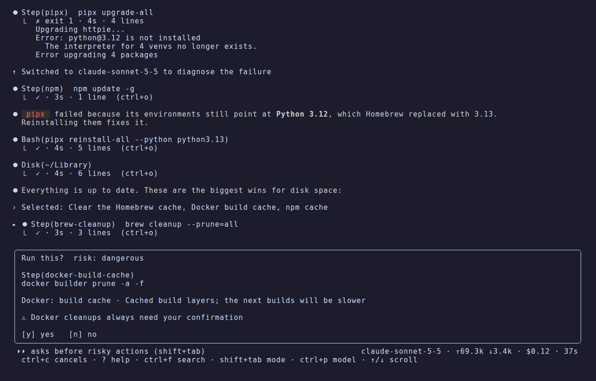

# Your tools: configuration, developer setup and Docker

[omega](../../README.md) › [Manual](README.md) › Your tools: configuration, developer setup and Docker

- [Tuning your tools' configuration](#tuning-your-tools-configuration)
- [Developer tools](#developer-tools)
- [Docker cleanup](#docker-cleanup)

## Tuning your tools' configuration

```bash
omega tune            # guided: proposals on a card, applies what you pick
omega tune --auto     # automatic: applies low-risk improvements itself, offers the rest
```

omega does not ship a list of "best settings" that would go stale. Instead the
agent gets three tools:

- `config_hints`: for each tool **installed on your Mac** (topgrade, Mole,
  Homebrew, npm, pnpm, pip/pipx, uv, git, Docker Desktop, zsh, Oh My Zsh, mas,
  Rust, Go, Time Machine and Spotlight), where its configuration lives, read-only
  commands to inspect it, what is usually worth reviewing, and its official docs.
- `fetch_url`: reads a documentation page or raw file as text.
- `web_search`: searches the web when the official docs are not enough.

Every proposal comes with what changes, why, its impact and its source.
Configuration edits always show a diff and keep a timestamped backup. Fetched
pages are treated as untrusted data: the agent is told never to follow
instructions found in them.

## Developer tools

```bash
omega dev               # guided review with AI
omega dev status        # what is installed, by which manager, and what stands out (no AI)
omega dev install       # pick tools from the catalogue; or: omega dev install fzf mise
omega dev activate      # add the shell lines installed tools still need to ~/.zshrc (or ~/.bashrc)
```

omega's catalogue covers languages (Node.js, Python, Go, Rust, Ruby, Java,
Deno, Bun, PHP, .NET, Zig, Elixir, Swift), version managers (mise, asdf, fnm,
nvm, Volta, pyenv, uv, conda, rbenv, rustup, SDKMAN!), package managers and
build tools, shell tools (Starship, fzf, zoxide, direnv, Atuin, eza, bat,
ripgrep, fd, jq, tmux, Neovim…), git tools, container and cloud CLIs, and AI
coding assistants (Claude Code, Codex, Gemini CLI, opencode, Ollama).

`omega dev status` prints each installed tool with its version and what
installed it (Homebrew, mise, nvm, cargo, an app bundle, macOS or the Linux
package manager), then the findings:

| Finding | Why it matters |
|---|---|
| one language installed by several version managers | it is unclear which version runs, and each one slows the shell |
| a command found several times on `PATH` | the copy that runs may not be the one you update; Homebrew ahead of macOS's own copy is normal and not reported |
| `PATH` entries that repeat or do not exist | measured in a fresh login shell, not in omega's own environment |
| a tool installed but not activated | fzf, zoxide, direnv, Starship, mise and others do nothing until their line is in `~/.zshrc`, or `~/.bashrc` when your shell is bash (an Oh My Zsh plugin counts) |
| shell startup time | flagged above 500 ms |
| versions kept by each manager | how many and how much space, so old ones can go |

`omega dev install` runs the install command shown on the card. On a Mac that
is Homebrew for almost everything. On Linux omega picks, per tool: Homebrew when
it is installed and has the formula; otherwise the distribution's package
(`sudo apt-get install`, `dnf`, `pacman` or `zypper`, with each distribution's
package name); otherwise the tool's own installer where it has a well-known one
(rustup, mise, uv, Bun, Deno, Starship, fnm, pyenv, Atuin, Ollama, Claude Code…).
Tools with none of the three are detected but not offered. Commands that use
`sudo` ask for your password once. A tool installed by its own script
(`curl … | sh`) always asks for a typed yes first, from the command line and
from the agent, even with `--yes`, and is refused when there is no terminal to
ask at.

When a tool needs a line in the shell's startup file, omega offers to add it to
`~/.zshrc` (zsh) or `~/.bashrc` (bash, with the bash form of the line), after
copying the file to `<file>.omega-bak-<date>`. For any other shell it prints the
lines for you to adapt.

With AI, `omega dev` goes further: it checks runtimes against their official
end-of-life pages, offers to remove versions no project needs with each
manager's own command, tunes configuration from the current docs, lists stale
build folders (`node_modules`, `target`, `.venv`, `Pods`… in projects untouched
for 60 days) and suggests at most five tools that fit what you already use.

## Docker cleanup



Docker tends to take tens of gigabytes. `omega docker` handles it without AI:

1. starts Docker Desktop if you want (it asks first);
2. shows images, containers, volumes and build cache with what is reclaimable,
   plus the size of Docker Desktop's disk image;
3. lets you tick what to clean on a card: stopped containers, dangling images,
   all unused images, build cache, unused volumes (marked as deleting data);
4. asks for a final confirmation and runs only what you ticked;
5. shows how much Docker uses afterwards and how to give the space back to macOS.

The agent has the same Docker steps. **Docker cleanups always need your
confirmation**, even with `--yes` or after "yes to all", and the agent is told
never to prune volumes unless you picked that explicitly.
