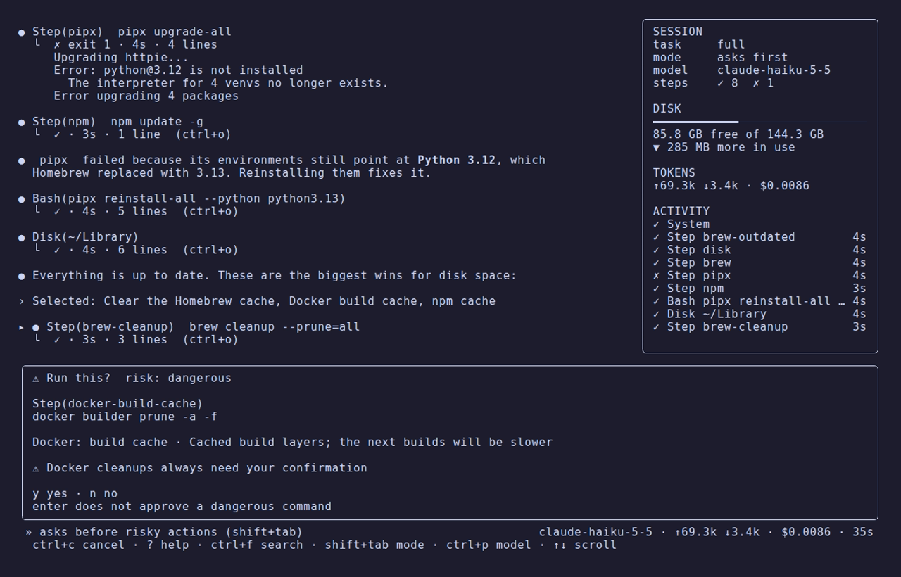

# Your tools: configuration, developer setup and Docker

[omega](../../README.md) › [Manual](README.md) › Your tools: configuration, developer setup and Docker

- [Tuning your tools' configuration](#tuning-your-tools-configuration)
- [Developer tools](#developer-tools)
- [Docker cleanup](#docker-cleanup)
- [Skills of your AI agents](#skills-of-your-ai-agents)
- [What AI agents left running](#what-ai-agents-left-running)

## Tuning your tools' configuration

```bash
omega tune            # guided: proposals on a card, applies what you pick
omega tune --auto     # automatic: applies low-risk improvements itself, offers the rest
```

omega does not ship a list of "best settings" that would go stale. It ships
the addresses of the official documentation and the agent reads it when it
needs it, on every platform:

- `official_docs`: the official documentation of **the system omega runs on**
  and of the tools installed there, plus how to read the manuals on the
  machine itself (`man`, `--help`, `Get-Help`), which match the installed
  version. On macOS that is Apple's user, deployment and security guides and
  the release notes; on Windows, Microsoft Learn (the commands reference, the
  component store, troubleshooting, release health, PowerShell); on Linux, the
  systemd and kernel manuals plus the distribution's own: Debian, Ubuntu,
  Fedora and its derivatives, Arch and openSUSE.
- `config_hints`: for each tool **installed here**, where its configuration
  lives, read-only commands to inspect it, what is usually worth reviewing and
  its official docs. It covers topgrade, Mole, Homebrew, mas, npm, pnpm, Yarn,
  Bun, pip/pipx, uv, conda, RubyGems, mise, Rust, Go, git, the GitHub CLI,
  OpenSSH, Docker, zsh, Oh My Zsh, bash, fish, Time Machine and Spotlight,
  apt, dnf, pacman, zypper, Flatpak, snap, systemd, winget, Scoop, Chocolatey,
  the PowerShell profile and WSL.
- `fetch_url`: reads a documentation page or raw file as text. Official
  documentation, the results of `web_search` and sites you name are read
  without asking; any other address needs your approval.
- `web_search`: searches the web when the page is not listed; results from the
  official documentation sites omega knows are marked `[official]`.

The agent is told to work from the documentation, not from memory: before a
fix, an optimisation or a setting that is not a step of omega's catalogue, it
finds where the vendor documents it, checks that it applies to the installed
version, applies only what the documentation supports and names the source.
Tweaks that only forums or blogs recommend are not applied.

Every proposal comes with what changes, why, its impact and its source.
Configuration edits always show a diff and keep a timestamped backup. Fetched
pages are treated as untrusted data: the agent is told never to follow
instructions found in them.

## Developer tools

```bash
omega dev               # guided review with AI
omega dev status        # what is installed, by which manager, and what stands out (no AI)
omega dev install       # pick tools from the catalogue; or: omega dev install fzf mise
omega dev activate      # add the shell lines installed tools still need to ~/.zshrc (or ~/.bashrc)
```

omega's catalogue covers languages (Node.js, Python, Go, Rust, Ruby, Java,
Deno, Bun, PHP, .NET, Zig, Elixir, Swift), version managers (mise, asdf, fnm,
nvm, Volta, pyenv, uv, conda, rbenv, rustup, SDKMAN!), package managers and
build tools, shell tools (Starship, fzf, zoxide, direnv, Atuin, eza, bat,
ripgrep, fd, jq, tmux, Neovim…), git tools, container and cloud CLIs, and AI
coding assistants (Claude Code, Codex, Gemini CLI, opencode, Ollama).

`omega dev status` prints each installed tool with its version and what
installed it (Homebrew, mise, nvm, cargo, an app bundle, macOS or the Linux
package manager), then the findings:

| Finding | Why it matters |
|---|---|
| one language installed by several version managers | it is unclear which version runs, and each one slows the shell |
| a command found several times on `PATH` | the copy that runs may not be the one you update; Homebrew ahead of macOS's own copy is normal and not reported |
| `PATH` entries that repeat or do not exist | measured in a fresh login shell, not in omega's own environment |
| a tool installed but not activated | fzf, zoxide, direnv, Starship, mise and others do nothing until their line is in `~/.zshrc`, or `~/.bashrc` when your shell is bash (an Oh My Zsh plugin counts) |
| shell startup time | flagged above 500 ms |
| versions kept by each manager | how many and how much space, so old ones can go |

`omega dev install` runs the install command shown on the card. On a Mac that
is Homebrew for almost everything. On Linux omega picks, per tool: Homebrew when
it is installed and has the formula; otherwise the distribution's package
(`sudo apt-get install`, `dnf`, `pacman` or `zypper`, with each distribution's
package name); otherwise the tool's own installer where it has a well-known one
(rustup, mise, uv, Bun, Deno, Starship, fnm, pyenv, Atuin, Ollama, Claude Code…).
Tools with none of the three are detected but not offered. Commands that use
`sudo` ask for your password once. A tool installed by its own script
(`curl … | sh`) always asks for a typed yes first, from the command line and
from the agent, even with `--yes`, and is refused when there is no terminal to
ask at.

When a tool needs a line in the shell's startup file, omega offers to add it to
`~/.zshrc` (zsh) or `~/.bashrc` (bash, with the bash form of the line), after
copying the file to `<file>.omega-bak-<date>`. For any other shell it prints the
lines for you to adapt.

With AI, `omega dev` goes further: it checks runtimes against their official
end-of-life pages, offers to remove versions no project needs with each
manager's own command, tunes configuration from the current docs, lists stale
build folders (`node_modules`, `target`, `.venv`, `Pods`… in projects untouched
for 60 days) and suggests at most five tools that fit what you already use.

## Docker cleanup



Docker tends to take tens of gigabytes. `omega docker` handles it without AI:

1. starts Docker Desktop if you want (it asks first);
2. shows images, containers, volumes and build cache with what is reclaimable,
   plus the size of Docker Desktop's disk image;
3. lets you tick what to clean on a card: stopped containers, dangling images,
   all unused images, build cache, unused volumes (marked as deleting data);
4. asks for a final confirmation and runs only what you ticked;
5. shows how much Docker uses afterwards and how to give the space back to macOS.

The agent has the same Docker steps. **Docker cleanups always need your
confirmation**, even with `--yes` or after "yes to all", and the agent is told
never to prune volumes unless you picked that explicitly.

## Skills of your AI agents

A skill is a folder with a `SKILL.md` that tells a coding agent how to do one
kind of task. Every agent reads its own folder of them and most also read the
shared one, so the same skill ends up copied by hand, linked, or missing where
you expected it. `omega skills` looks after them without AI and without a key:

```bash
omega skills                              # the agents on this machine and every skill
omega skills audit                        # only what is wrong
omega skills install anthropics/skills --skill pdf
omega skills sync                         # every installed agent sees every skill
omega skills update                       # bring the installed ones up to date
omega skills remove pdf
```

These are the personal folders omega reads, as each agent's documentation
states them:

| Agent | Reads |
|---|---|
| Claude Code | `~/.claude/skills` |
| Codex CLI | `~/.agents/skills` |
| Gemini CLI | `~/.agents/skills`, `~/.gemini/skills` |
| opencode | `~/.config/opencode/skills`, `~/.claude/skills`, `~/.agents/skills` |
| Cursor | `~/.agents/skills`, `~/.cursor/skills`, `~/.claude/skills` |
| GitHub Copilot CLI | `~/.agents/skills`, `~/.copilot/skills` |

An agent counts as installed when its command is on `PATH` or its
configuration folder exists. Skills kept inside a project (`.claude/skills`,
`.agents/skills`) belong to that repository and are left alone.

- **List** shows, for each skill, where it is (`shared` is `~/.agents/skills`),
  whether each place is a folder or a link, where omega installed it from, and
  what the audit found. `omega skills --json` prints the same as JSON.
- **Audit** reports links to folders that no longer exist, a `SKILL.md` without
  its `---` block, a missing or invalid `name`, a missing or too long
  `description`, copies of one skill whose content differs, and the installed
  agents that cannot see a skill.
- **Install** takes a folder, a git URL, a GitHub link to a folder
  (`https://github.com/owner/repo/tree/main/skills/pdf`) or `owner/repo`. It
  finds the skills at the top, one folder down and under `skills/`; `--skill`
  picks some of them. The files are copied once, to the folder most agents
  read, and the agents that do not read it get a link to that copy (a copy with
  `--copy`, or where the system refuses links). `--to claude,codex` installs
  for those agents only. Links inside a repository and its `.git` are never
  copied. A skill that is already installed is left alone unless `--force`.
- **Sync** links each skill into the folders of the agents that cannot see it,
  with the fewest links that do it. It overwrites nothing: a skill whose copies
  differ is reported and left for you to settle. `--dry-run` only says what it
  would do.
- **Update** goes back to where each skill came from: a new commit in the
  repository, or changed files in the folder. `--check` only looks. A skill you
  edited after installing it is left alone unless `--force`, and then the
  edited folder goes to the trash first. Skills omega did not install have no
  source and are reported as not tracked.
- **Remove** shows what goes and asks. Links are deleted; folders are moved to
  the Trash on a Mac and to `~/.local/state/omega/removed-skills` elsewhere.
  `--from claude` removes it from one place only, and `--yes` does not ask.

Agents read their skills when they start, so one that is already running sees
a change after a restart. The desktop app has the same in its **Skills** view.

## What AI agents left running

Agent sessions end; the dev servers, watchers and emulators they started do
not. `omega agents` finds them and ends them, without AI and without a key
(`omega claude` is the same command):

```bash
omega agents                    # what closed sessions left, and the open sessions
omega agents kill               # end everything closed sessions left behind
omega agents kill 4242 5d1e     # one process, and what one session left
omega agents end 7f3a           # end an open session and what it runs
omega agents idle --after 3h    # end the Claude Code sessions waiting for 3 hours
```

Most agents put a variable in the environment of every command they run.
omega reads those variables from your own processes (`ps` on macOS, `/proc` on
Linux), and a process is left behind once the agent that started it is gone
and no other agent runs above it. These are the agents it knows, with what
their source code sets:

| Agent | Marks its commands with | Session |
|---|---|---|
| Claude Code | `CLAUDECODE=1`, `CLAUDE_PID` | `CLAUDE_CODE_SESSION_ID`, status in `~/.claude/sessions` |
| Codex | `CODEX_THREAD_ID` | the thread |
| Gemini CLI | `GEMINI_CLI=1` | none |
| Qwen Code | `QWEN_CODE=1` | `QWEN_CODE_SESSION_ID` |
| opencode | `OPENCODE=1`, `OPENCODE_PID` (1.x) | `OPENCODE_SESSION_ID` (2.x) |
| Kilo Code | `KILO=1`, `KILO_PID` | none |
| Cursor CLI | `CURSOR_AGENT=1` | `CURSOR_CONVERSATION_ID` |
| GitHub Copilot CLI | `COPILOT_CLI=1` | `COPILOT_AGENT_SESSION_ID` |
| Crush | `CRUSH=1` | none |
| Goose | `GOOSE_TERMINAL=1` | `AGENT_SESSION_ID` |
| Amp, Aider | nothing confirmed | open sessions only |

Cursor's variables come from its published bundle and Copilot's from its
changelog; the rest from each project's source. An agent that marks nothing
still shows as an open session with what runs under it, but once it is gone
what it left cannot be told from any other process. Some programs keep their
environment unreadable, Chrome among them, so whatever a marked process
started counts too: a browser Playwright opened shows up next to Playwright,
and an app's helper processes are folded into one row with the app.

- **The list** groups the leftovers by agent and session, with the project and,
  for Claude Code, the title it gave the session; each process's ports, memory
  and age, and where it runs. The open sessions come after it. Only Claude Code
  records whether a session is working or idle, in a file that is not a
  documented interface: when it is missing a session still shows, without a
  status. Codex's `app-server` and opencode's `serve` show as background
  services, which other sessions use and which are not ended from here.
  `--json` prints the whole report.
- **Agents inside agents.** A command started by Codex that Claude Code started
  carries both markers: it belongs to the nearest agent still running above it,
  and a process under any running agent is never left behind.
- **Shared daemons** an agent's command happened to start, like git's
  `fsmonitor--daemon`, `mutagen daemon`, 1Password's `op daemon`, `ssh-agent`
  or `gpg-agent`, are listed but kept when everything, a session's worth or a
  session is ended: the rest of the machine uses them. Name one by its PID to
  end it.
- **Ending** asks each process to exit, waits two seconds and forces what did
  not. Before that it checks that each PID still runs the command it listed: a
  PID the system has since given to something else is left alone. It asks
  first; `--yes` skips the question and is required without a terminal.
- **Idle sessions** are the ones waiting for your input for longer than
  `--after` (two hours unless you say, never under 30 minutes): Claude Code
  sessions, the only ones with a status. Ending one ends its `claude` process
  and what it runs.
- The session omega itself runs in is never ended, and neither is omega.

It works on macOS and Linux. Windows does not let one program read another's
environment, so there the command says so and does nothing. The desktop app has
the same in its **AI agents** view, which looks again every five seconds while
it is open and marks the view with a dot when something was left behind.
